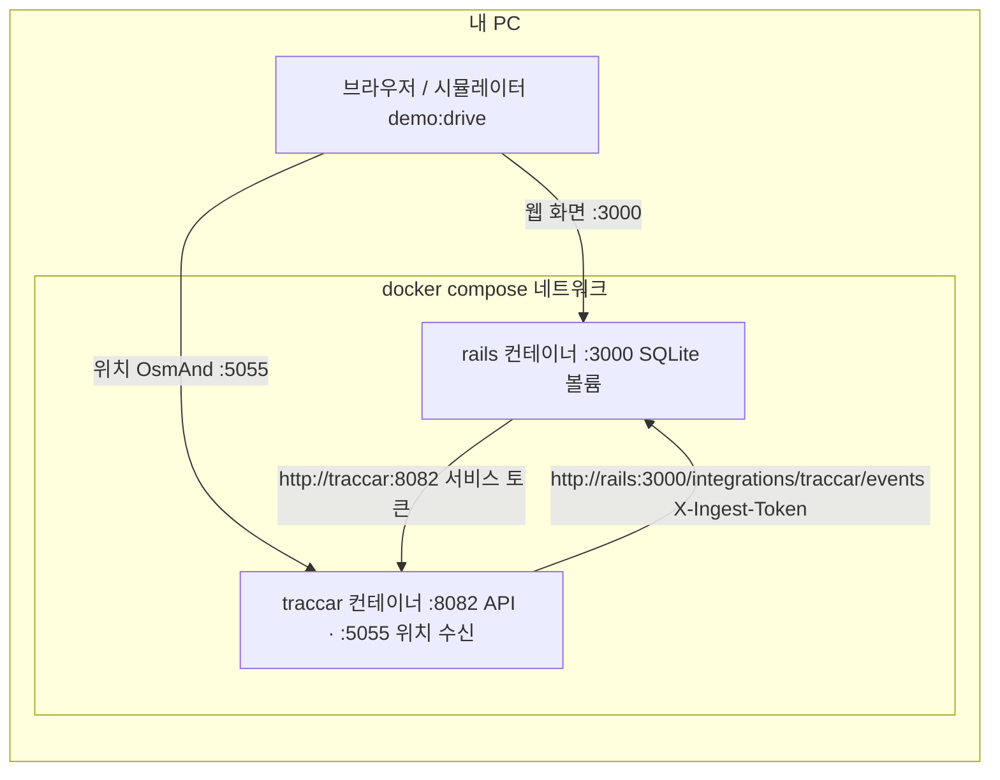
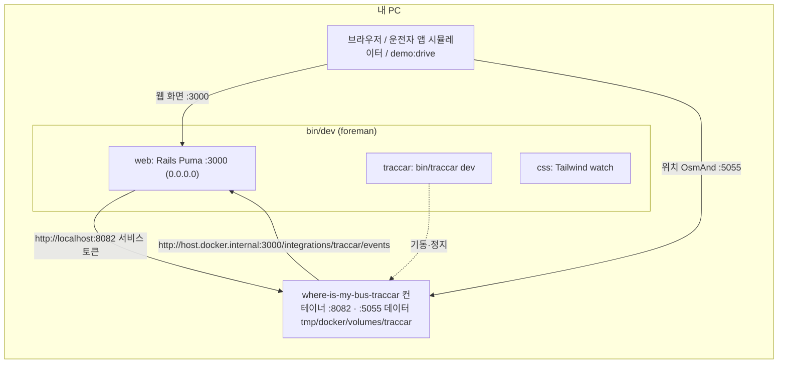
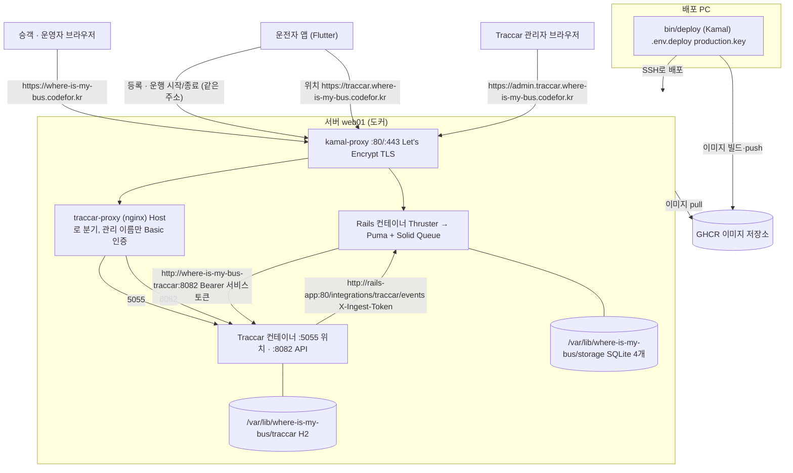
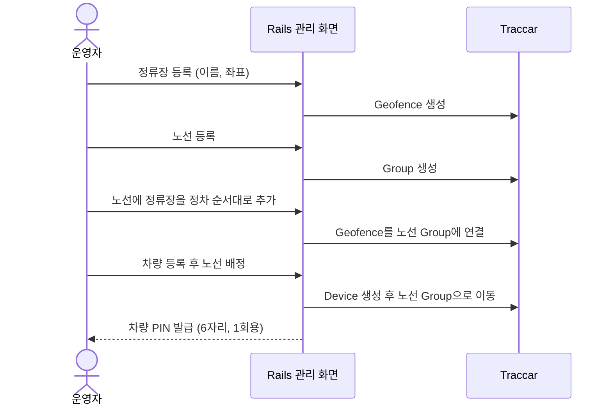
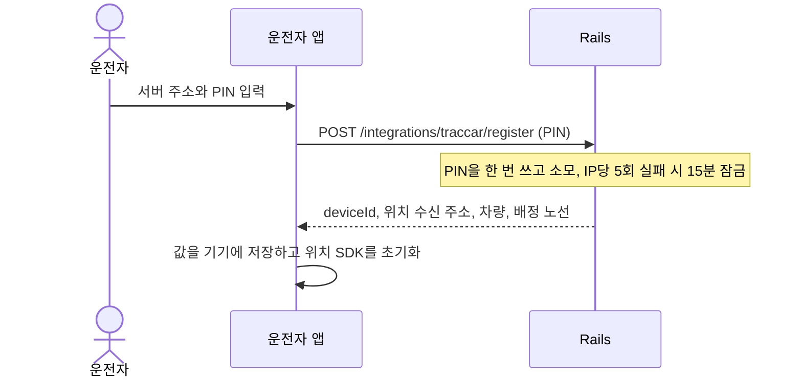
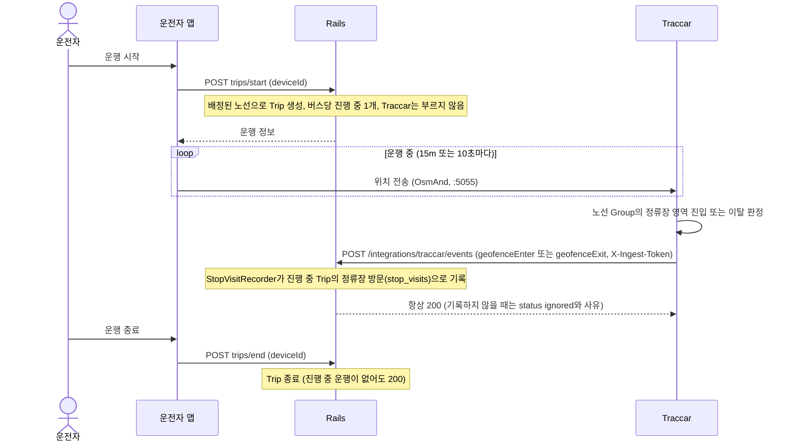
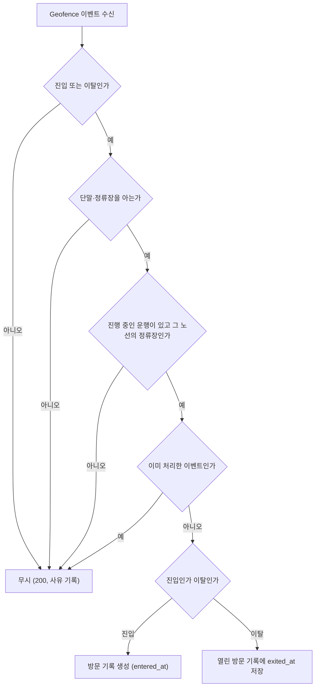
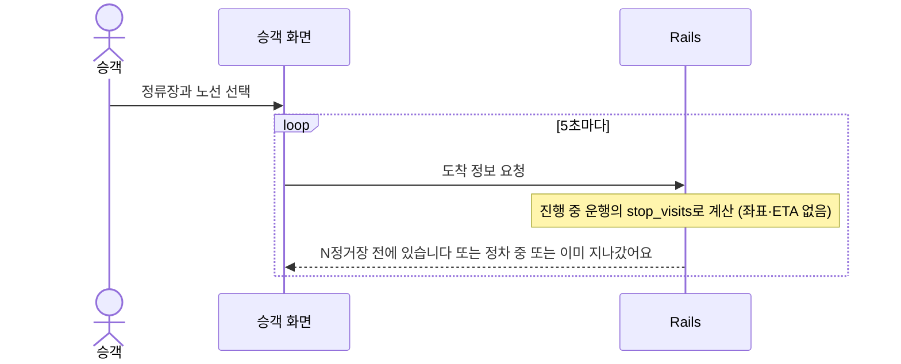

# 내 버스는 언제 올까?

BIS(버스정보시스템)에 등록되지 않은 시골·도서 지역의 노선버스 위치를 시민에게 알려주는 서비스입니다.
버스가 언제 올지 막연히 기다려야 하는 시골버스의 불편함을 해결하는 것을 목표로 합니다.

> Code for Korea 프로젝트

이 저장소는 모노레포입니다. 루트는 **웹 애플리케이션(Rails)**, `driver_app/`은 버스 운전자용 **Flutter 앱**입니다.

## 어떻게 동작하나

GPS 좌표를 쌓아 두고 가까운 정류장을 계산하는 방식이 아니라, **정류장에 들어가고 나갈 때 [Traccar](https://www.traccar.org/)가 알려 주는 Geofence 이벤트를 기록**해서 "버스가 지금 어느 정류장에 있는지"를 알려 줍니다. Rails는 GPS 좌표를 저장하지 않습니다.

```
관리자 ── 정류장·노선 등록, 차량에 노선 배정 ──▶ Rails ──▶ Traccar (정류장 영역·노선 그룹·기기 생성)
운전자 앱 ── 운행 시작·종료 ──▶ Rails
운전자 앱 ── 위치(OsmAnd) ──▶ Traccar ── 정류장 영역 진입/이탈 이벤트 ──▶ Rails (방문 기록) ──▶ 승객 화면
```

- 설계 결정과 근거: [docs/design-event-driven-rewrite.md](docs/design-event-driven-rewrite.md)
- Traccar 연동 상세(자원 대응·이벤트 흐름·설정·보안): [docs/traccar-integration.md](docs/traccar-integration.md)
- 데이터 모델이 왜 이렇게 바뀌었나: [docs/data-model-rewrite.md](docs/data-model-rewrite.md), ERD: [docs/erd.md](docs/erd.md)
- 실시간 운행 안내(N분 후 도착) 설계·승객 화면 메시지 정의: [docs/design-realtime-eta.md](docs/design-realtime-eta.md)
- 제품 요구사항·정책 초안·남은 과제: [docs/product_requirements.md](docs/product_requirements.md), [docs/policy-draft.md](docs/policy-draft.md), [docs/future-improvements.md](docs/future-improvements.md)

---

## 구성 요소

| 대상 | 영역 | 설명 |
|---|---|---|
| 승객 | `/` | 정류장을 고르고(필요하면 노선을 골라) 그 노선 버스가 어느 정류장에 있는지 확인 (5초마다 갱신) |
| 운영자 | `/admin` | 노선·정류장·차량 관리, 차량에 노선 배정, 노선에 정류장 추가, 대시보드(운행 중인 버스·최근 정류장 방문) |
| 운전자 | `driver_app/` (Flutter) | PIN으로 기기 등록, 운행 시작·종료, 위치를 Traccar로 전송, 이전·현재·다음 정류장 표시 |

승객 화면은 **정류장 단위**로 알려 줍니다("N정거장 전에 있습니다", "○○ 정차 중"). 좌표 기반 도착 예정 시간(ETA)은 제공하지 않습니다.

---

## 시스템 구성도

세 환경 모두 같은 구조(Rails ↔ Traccar)이고, **누가 어디서 도느냐와 주소**만 다릅니다. 자세한 설정은 [docs/local-demo.md](docs/local-demo.md)(로컬), [docs/deployment.md](docs/deployment.md)·[docs/traccar-accessory.md](docs/traccar-accessory.md)(운영)에 있습니다.

### 로컬 개발 — A. `docker compose`

Rails와 Traccar가 모두 컨테이너입니다. 서로 서비스 이름(`rails`, `traccar`)으로 부릅니다.



### 로컬 개발 — B. `bin/dev`

Rails는 내 PC에서 직접 돌고(`foreman`: web, css, traccar), Traccar만 컨테이너입니다. 컨테이너가 호스트 Rails를 `host.docker.internal`로 부릅니다.



두 방식은 같은 포트(8082·5055)를 쓰므로 동시에 띄울 수 없습니다. 고르는 법은 [docs/local-demo.md](docs/local-demo.md)의 "어떤 방식으로 띄울까"를 보세요.

### 실서버 (Kamal, 서버 1대)

Rails와 Traccar가 **한 서버의 도커 네트워크**에 같이 있고, 서버 밖에서는 `kamal-proxy`(80/443)만 HTTPS로 받습니다.



| 구분 | 로컬 compose | 로컬 `bin/dev` | 실서버 |
|---|---|---|---|
| Rails | 컨테이너 | 내 PC | 컨테이너(Kamal, GHCR 이미지) |
| Traccar | compose 서비스 | 컨테이너 1개 | Kamal accessory + nginx 앞단 |
| Rails → Traccar | `http://traccar:8082` | `http://localhost:8082` | `http://where-is-my-bus-traccar:8082` |
| Traccar → Rails | `http://rails:3000` | `http://host.docker.internal:3000` | `http://rails-app:80` |
| 위치 수신 주소(`TRACCAR_SERVER_URL`) | `http://localhost:5055` | `http://localhost:5055` | `https://traccar.where-is-my-bus.codefor.kr` |
| HTTPS | 없음 | 없음 | kamal-proxy가 인증서 발급·종단 |
| 데이터 | 도커 볼륨 | `storage/`, `tmp/docker/volumes/traccar` | 서버 호스트 디렉터리(컨테이너 밖) |
| 토큰 | `dev-traccar-*`(공개 값) | 같음 | 새로 만든 값(`.env.deploy`), 개발 값이면 부팅 실패 |

- 서버 밖에서 Rails ↔ Traccar 호출이 오가지 않습니다. 이벤트 포워딩과 API 호출은 모두 서버 안 도커 네트워크입니다.
- 임시로 평문 5055와 8082가 서버 밖에 게시되어 있습니다. HTTPS 전환이 끝나면 게시와 보안 그룹 규칙을 지웁니다(`docs/deployment.md`).
- 위 구성도에서 Rails 컨테이너 앞 `Thruster`는 정적 파일 캐시·압축을 맡는 프록시이고, `Solid Queue`는 Puma 안에서 돕니다(`SOLID_QUEUE_IN_PUMA`).

---

## 동작 프로세스

버스 한 대가 정류장을 지나는 것이 승객 화면에 나타나기까지를 네 단계로 나눠 봅니다. 환경(로컬·실서버)과 무관하게 같습니다.

### 1. 준비 — 운영자가 등록한다

정류장·노선·차량을 저장하면 **같은 트랜잭션 안에서 Traccar에도 만들어집니다.** Traccar 호출이 실패하면 Rails 변경도 취소됩니다(`*Registration`).



노선별 Group 구조 덕분에 **그 노선의 정류장 영역을 지날 때만** 이벤트가 옵니다(2번 버스가 1번 노선의 시장 정류장을 지나도 기록되지 않습니다).

### 2. 기기 등록 — 운전자 앱이 PIN으로 연결한다



기기를 바꾸거나 PIN이 새면 운영자가 "PIN 재발급"을 합니다.

### 3. 운행 — 위치가 정류장 방문 기록이 된다



Rails는 좌표를 받지도 저장하지도 않습니다. 인증 실패(401)를 뺀 모든 이벤트에 200으로 답하는 것은 4xx를 주면 Traccar의 재시도가 폭주하기 때문입니다.

이벤트를 받았을 때의 판단:



### 4. 조회 — 승객이 정류장 단위로 본다



---

## 기술 스택

- **Ruby** 4.0.9 / **Rails** 8.1 (`.tool-versions`로 asdf 고정)
- **DB**: SQLite (운영도 파일 DB)
- **프론트**: Hotwire(Turbo/Stimulus) + importmap, **Tailwind CSS 4**
- **인증**: Rails 8 내장 인증(세션 + `has_secure_password`)
- 백그라운드/캐시/케이블: Solid Queue / Solid Cache / Solid Cable
- 위치 서버: Traccar (Docker, `compose.yaml`)
- 배포: Kamal + GHCR 이미지, 운영 Traccar는 같은 서버의 accessory ([docs/deployment.md](docs/deployment.md))

---

## 도메인 모델

```
Route (노선) ─< RouteStop >─ Stop (정류장)     정류장은 독립된 장소, 여러 노선이 공유
Route ─< Bus (차량)                             차량 1대에 노선 1개를 관리자가 배정 (buses.route_id)
Bus ─< Trip (운행) ─< StopVisit >─ Stop          운전자가 시작·종료, 버스당 진행 중인 운행 1개
User ─< Session                                  role: member / operator — 첫 가입자는 자동으로 operator
```

테이블은 8개(`buses`, `routes`, `route_stops`, `stops`, `stop_visits`, `trips`, `users`, `sessions`)입니다. 시·도/운행지역 계층, 좋아요, 영어 화면, GPS 로그, 좌표 기반 ETA는 요구사항에 없거나 새 구조와 맞지 않아 뺐습니다(다시 넣을지는 팀 논의 대상 — [docs/team-discussion-agenda.md](docs/team-discussion-agenda.md)).

---

## 시작하기

### 가장 쉬운 방법: Docker (Rails + Traccar)

Docker Desktop이 있으면 한 번에 실행됩니다. 처음 기동 때 시드가 실행되어 정류장 6개, 노선 2개, 차량 2대가 만들어지고 Traccar에도 같은 자원이 생깁니다.

```bash
docker compose up -d --build
docker compose exec rails bin/rails "demo:drive[1번]"   # 폰 없이 버스 한 대를 운행시키는 시뮬레이터
```

- 승객 화면 <http://localhost:3000/> · 관리자 <http://localhost:3000/admin> · Traccar <http://localhost:8082>
- 관리자 계정과 차량 PIN·`deviceId`는 `docker compose logs rails`에 출력됩니다.
- 자세한 시연 순서·문제 해결, compose와 bin/dev 중 고르는 법: [docs/local-demo.md](docs/local-demo.md)

### Rails를 직접 실행

사전 준비: [asdf](https://asdf-vm.com/)로 Ruby 4.0.9 설치(`.tool-versions` 참고)

```bash
bundle install
bin/dev            # Rails 서버 + Tailwind watch + 로컬 Traccar(Docker가 있으면 bin/traccar가 함께 뜬다. TRACCAR=0이면 제외)
```

노선·정류장·차량을 등록하거나 데모 시드(`bin/rails demo:seed`)를 실행하려면 **Traccar 서버가 떠 있어야** 합니다(등록이 Traccar 호출과 한 트랜잭션으로 묶여 있음). Traccar 접속 정보는 환경변수(`TRACCAR_API_BASE_URL`, `TRACCAR_API_TOKEN`, `TRACCAR_INGEST_TOKEN`, `TRACCAR_SERVER_URL`)가 credentials보다 우선하며, 표와 설정 방법은 [docs/traccar-integration.md](docs/traccar-integration.md)에 있습니다. `bin/dev`는 Docker가 있으면 Traccar 컨테이너를 함께 띄우고 Rails가 그 Traccar(`localhost:8082`)를 쓰도록 위 환경변수를 채웁니다(`bin/traccar`, 컨테이너 이름 `where-is-my-bus-traccar`, 데이터는 `tmp/docker/volumes/traccar`). Traccar만 따로 다루려면 `bin/traccar up|down|status|logs|reset`을 씁니다. `reset`으로 Traccar 데이터를 지웠다면 `bin/rails traccar:sync`로 노선·정류장·차량을 다시 등록합니다. `docker compose`의 Traccar와는 같은 포트(8082·5055)를 쓰므로 동시에 띄울 수 없습니다.

- 회원가입: <http://localhost:3000/registration/new> — **첫 가입자가 운영자**가 됩니다
- 로컬 개발 DB를 이전 구조에서 가져왔다면 `bin/rails db:reset`이 필요합니다.

### 운전자 앱

[Flutter SDK](https://docs.flutter.dev/get-started/install) 설치 후:

```bash
cd driver_app && flutter pub get && flutter run
```

번들 ID — Android `com.tenminutestudio.whereismybusdriver.AOS` / iOS `com.tenminutestudio.whereismybusdriver.iOS`. 서버 주소 설정과 iOS 시뮬레이터 시험 절차는 [driver_app/README.md](driver_app/README.md)를 참고하세요.

---

## 주요 경로

| 경로 | 설명 |
|---|---|
| `/` | 승객 첫 화면 (정류장 선택) |
| `/stops/:id` | 정류장에 서는 노선 선택 (정류장 QR이 가리키는 주소) |
| `/stops/:stop_id/routes/:route_id` | 그 정류장에서 본 노선 버스 위치 (`/status`가 5초 폴링용 응답, `/detail`이 자세히 보기) |
| `/about` | 서비스 소개 |
| `/admin` | 운영자 대시보드 및 관리 (노선·정류장·차량, 노선 배정, 운영자 지침) |
| `/registration/new`, `/session/new` | 가입 / 로그인 |
| `POST /integrations/traccar/register` | 운전자 앱: PIN으로 기기 등록 (1회용 PIN) |
| `GET /integrations/traccar/bus` | 운전자 앱: 차량·배정 노선·진행 중인 운행 조회 |
| `POST /integrations/traccar/trips/start`, `.../trips/end` | 운전자 앱: 운행 시작·종료 |
| `POST /integrations/traccar/events` | Traccar가 Geofence 이벤트를 포워딩하는 수신 엔드포인트 (`X-Ingest-Token` 인증) |

---

## 개발 명령

```bash
bin/rails test        # 테스트 (Minitest, 전체)
bin/ci                # rubocop + gem/importmap audit + brakeman (CI와 같은 구성)
bin/rubocop           # 스타일
```

- ⚠️ **GitHub Actions CI에는 테스트 잡이 없습니다** — rubocop / brakeman / bundler-audit / importmap audit만 돕니다. 테스트는 로컬에서 직접 실행해 주세요. `driver_app`은 CI가 무시하므로 `flutter analyze`·`flutter test`도 로컬에서 실행해야 합니다.
- 관리자 영역은 `Admin::BaseController`에서 운영자 권한을 강제합니다.
- AI 코딩 에이전트용 프로젝트 가이드는 [AGENTS.md](AGENTS.md)에 있습니다.

---

## 현재 상태 / 다음 단계

- ✅ 데이터 모델·관리자 화면·승객 화면·운전자 앱 API를 Geofence 이벤트 기반으로 재작성
- ✅ 로컬 데모(Docker Compose + 시뮬레이터)와 시뮬레이터 위치 전송 시험(통과 40/40, [docs/location-sampling-test.md](docs/location-sampling-test.md))
- ✅ Android 실기기(Galaxy A51, Android 13)로 폰 → Traccar → Geofence → Rails 방문 기록까지 시험
- ⬜ iOS 실기기 시험, 백그라운드·화면 꺼짐·배터리·GPS 오차 검증
- ⬜ 운영 배포(Kamal 설정 확정), 운영 주소·https 설정
- ⬜ Trip 자동 종료 — 운전자가 종료를 누르지 않으면 운행이 열린 채 남음 ([docs/future-improvements.md](docs/future-improvements.md) 3번)
- ⬜ 운행 시작·종료 API 인증 강화 — 현재는 `deviceId`만으로 인증 (같은 문서 2번)
- ⬜ 운전자 앱: 정류장 크라우드소싱 등록 화면, 앱스토어/플레이스토어 배포 파이프라인
- ⬜ 비밀번호 재설정 메일 발송 설정(SMTP / 개발용 letter_opener)

⚠️ **임시 설정 남아있음** — Android cleartext 예외(`network_security_config.xml`)와 운전자 앱에 내려주는 Traccar 서버 주소(`TRACCAR_SERVER_URL`) 기본값이 로컬 개발용입니다. 실배포 서버 주소가 확정되면 원복·교체가 필요합니다 — 전체 목록은 [`driver_app/ISSUE.md`](driver_app/ISSUE.md) 상단 "임시 설정 (원복 필요)" 섹션을 참고하세요.

---

## 주요 변경 이력

날짜별 전체 이력은 `git log`와 PR에서 볼 수 있고, 여기에는 구조나 운영에 영향을 준 변경만 적습니다. 이후 변경으로 대체된 항목은 그렇게 표시합니다.

### 2026-10-27 — Geofence 이벤트 기반으로 재작성 (#23)

- 데이터 모델을 12개 테이블에서 8개로 줄이고, "GPS 좌표 누적 + 가까운 정류장 계산"을 "Geofence 진입/이탈 이벤트를 `stop_visits`에 기록"으로 바꿈. 정류장이 노선에서 독립되어 여러 노선이 공유하고, 차량에 노선을 하나 배정하며, 운행(Trip)은 운전자가 시작·종료함 ([docs/data-model-rewrite.md](docs/data-model-rewrite.md))
- 운전자 앱 API 변경(**이전 버전과 호환되지 않음**): `positions`·`routes` 제거, `bus`·`trips/start`·`trips/end`·`events` 추가, `register`는 유지하되 응답 변경
- 제거: 시·도/운행지역 계층, 좋아요, 영어 화면, 좌표 기반 ETA, GPS 로그
- GA4 추적 코드는 6단계 "승객 화면" 커밋 `6609fa5`(2026-10-23)에서 함께 삭제됐다가 #20에서 복원함. `layouts/service.html.erb`의 gtag(production만)와 `app/javascript/ga4.js`를 되살리고, 페이지뷰는 Turbo 이동도 집계하도록 `turbo:load`마다 `ga4.js`가 보내며 `page_path`는 `/노선명/정류장명`(body의 `data-ga4-page-path`), `arrival_status`는 화면을 열 때 상태(`arriving`/`approaching`/`passed`/`unknown`/`no_bus`)를 1회 전송, `select_bus`는 유지함. 좋아요·상세 보기 기능이 없어져 `like_stop`·`view_detail`은 복원하지 않았고, 예전 `page_path`(`/:지역명/:버스번호/:정류장명`)와 UTM 구분은 이어지지 않음. 원래 코드는 `e92b1c3`(2026-06-26)에서 추가됐음
- 이 PR에서 CI도 정리: Ruby 4.0.9, gem 보안 업데이트(`net-ssh`, `crass` 등), brakeman 8.1.0

### 2026-09-18 — 차량 등록·PIN 보안 (#17, #18, #19)

- 정류장 등록 시 Traccar geofence 자동 생성, 차량 등록 시 Traccar device 자동 프로비저닝. 노선은 Traccar group, 정류장 연결은 group 단위로 함 (2026-10-27 재작성에서 노선 배정 방식은 바뀌었으나 자원 대응은 유지 — [docs/traccar-integration.md](docs/traccar-integration.md))
- register PIN을 **1회용**으로 처리(유출돼도 같은 PIN으로 다른 기기가 추가 등록할 수 없음)하고 동시 요청 경쟁 상태를 방지함
- 차량 등록 시 Traccar 연동 실패로 롤백되면 재시도가 막히던 버그 수정

### 2026-09-16 — 관리자 화면

- 차량 PIN·`traccar_unique_id` 자동 생성, PIN 재발급 버튼(유출 대응, 재발급하면 기존 PIN 즉시 무효화)
- 차량 목록에서 PIN 컬럼 제거(보안) — 상세 화면에서만 노출
- "신규등록 운영자 지침" 페이지 추가
- 노선·정류장·차량 화면에 최종수정일자 표시 (당시 있던 시·도/운행지역 화면의 표시는 재작성에서 화면과 함께 삭제됨)

---

## License & Open Source Acknowledgments

- This project is licensed under the **Apache License 2.0** - see the [LICENSE.txt](LICENSE.txt) file for details.
- This project utilizes **Traccar**, which is also licensed under the **Apache License 2.0**. For more information, please visit [Traccar Official Website](https://www.traccar.org/).
