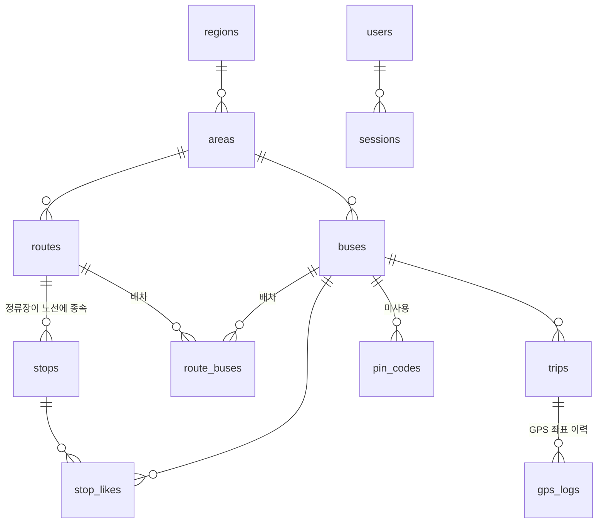
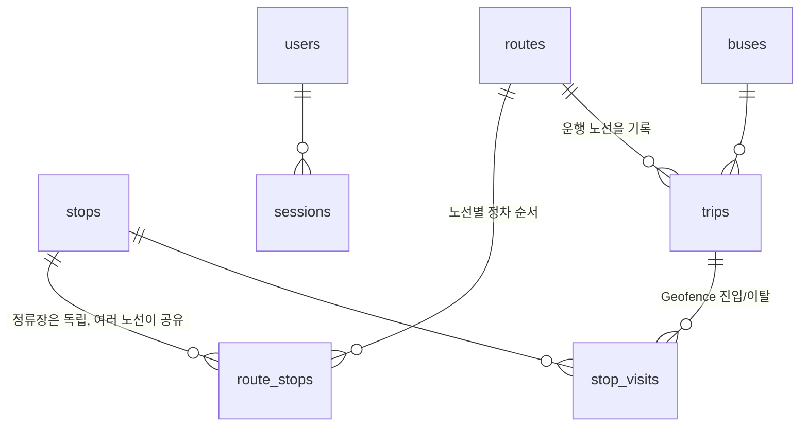

# 데이터 모델 재작성: 무엇이 어떻게 바뀌었고 왜 그렇게 했나

이 문서는 `main`의 기존 데이터 모델과 `feature/event-driven-rewrite`의 새 데이터 모델을 비교하고, 바꾼 이유를 설명한다.
팀원이 코드를 열기 전에 "무엇이 달라졌는지"를 이해하는 것이 목적이다.

- 기존 구조의 자세한 ERD: `docs/erd.md` (origin/main 기준)
- 기존 구조의 결함 목록: `docs/business-logic-review.md`
- 새 구조의 설계 전체: `docs/design-event-driven-rewrite.md`
- 이번 범위에서 미룬 것: `docs/future-improvements.md`
- 실행 방법: `docs/local-demo.md`

## 1. 한 문장 요약

**"버스 GPS 좌표를 쌓아 두고 가까운 정류장을 계산하던 구조"를 "정류장에 들어가고 나갈 때 Traccar가 알려주는 이벤트를 기록하는 구조"로 바꿨다.**
이에 맞춰 정류장·노선·운행·버스의 관계도 요구사항(`docs/product_requirements.md`)에 맞게 다시 정리했다.

| | 기존 (main) | 새 구조 |
|---|---|---|
| 테이블 수 | 12개 | **8개** |
| 버스 위치를 아는 방법 | GPS 좌표 → 가장 가까운 정류장을 계산 | Traccar Geofence 진입/이탈 이벤트를 방문 기록으로 저장 |
| 정류장 | 한 노선에 종속 (노선마다 따로 등록) | 독립된 장소. 여러 노선이 공유 |
| 버스와 노선의 관계 | 미리 배차(N:N)해 둠 | 운전자가 **운행을 시작할 때** 노선을 고름 |
| 운행(Trip) | 첫 GPS가 오면 자동 생성, 끝나는 코드가 없음 | 운전자가 시작·종료. 버스당 진행 중인 운행은 1개 |
| 지역 계층 | 시·도 → 운행지역 → 노선 | 없음 |
| 좋아요, 다국어 | 있음 | 없음 |

## 2. 왜 바꿨나

### 2-1. 요구사항과 기존 모델이 맞지 않았다

`docs/product_requirements.md`의 핵심은 세 가지다.

1. 관리자가 정류장을 등록하면 Traccar에 **Geofence가 자동 생성**되고, 버스의 도착/출발을 **Geofence 진입/이탈 이벤트**로 감지한다.
2. 운전자가 버스의 GPS를 전송한다.
3. 승객이 **정류장을 기준으로**, 기다리는 **노선**의 버스가 **어느 정류장에 있는지** 조회한다.

기존 모델로는 1번과 3번을 달성할 수 없었다.

| 요구 | 기존 모델의 문제 |
|---|---|
| 도착/출발을 Geofence 이벤트로 감지 | 이벤트를 받는 엔드포인트도, 저장할 테이블도 없었다. 위치는 GPS 좌표와 "가장 가까운 정류장" 계산으로만 추정했다 |
| 정류장 기준으로 노선을 고른다 | 정류장이 노선 하나에 종속(`stops.route_id`)이라, 여러 노선이 서는 정류장은 노선 수만큼 중복 등록하고 Geofence도 겹쳐 생겼다 |
| 어느 노선의 버스인가 | 운행(`trips`)에 노선 정보가 없었다. 버스가 여러 노선에 배정되면 지금 어느 노선을 뛰는지 알 수 없었다 |
| 버스가 정류장에 "있다"는 판단 | 가장 가까운 정류장일 뿐이라 정차 중인지, 정류장 사이를 지나는 중인지 구분하지 못했다 |

### 2-2. 기존 모델은 로직 결함을 구조적으로 품고 있었다

`docs/business-logic-review.md`에서 찾은 결함 중 상당수는 코드 몇 줄이 아니라 **모델의 모양** 때문이었다.
고치려면 모델을 바꿔야 해서, 부분 수정보다 처음부터 다시 짓는 쪽이 빨랐다 (11절에서 항목별로 어떻게 해소됐는지 정리한다).

### 2-3. 기존 데이터를 보존할 필요가 없었다

운영 데이터가 없는 개발 단계라서, 호환성을 위한 이관 비용 없이 모델을 바꿀 수 있었다.
이 점이 "갈아엎기"를 가능하게 했다. 대신 **기존 DB와는 호환되지 않는다** (12절).

## 3. 전후 구조 한눈에 보기

관계만 단순화한 그림이다. 컬럼을 포함한 ERD는 `docs/erd.md`(기존)와 `docs/design-event-driven-rewrite.md` 3절(새 구조)에 있다.

### 기존 (main)

### 새 구조

## 4. 테이블별 변화

| 기존 | 새 구조 | 무엇이 달라졌나 | 이유 |
|---|---|---|---|
| `regions`, `areas` | 삭제 | 시·도 → 운행지역 계층 제거 | 요구사항에 없고, 노선·버스·정류장 조회를 모두 이 계층을 거치게 만들어 모델을 복잡하게 했다 |
| `routes` | `routes` | 소속 운행지역, 배차 간격, 순서, 좋아요 수, 정류장 수 컬럼 제거. `traccar_group_id`만 유지 | 요구사항에 필요한 것만 남김. 노선은 이름과 Traccar 그룹만 있으면 된다 |
| `stops` | `stops` | `route_id`, `sequence`, `avg_travel_seconds`, 영문명 제거. 좌표는 필수, `traccar_geofence_id`는 유니크 | 정류장을 "장소"로만 정의. 노선과의 관계는 `route_stops`로 분리 |
| (없음) | **`route_stops`** | 노선·정류장·정차 순서. `(노선, 정류장)`과 `(노선, 순서)`가 유니크 | 한 정류장이 여러 노선에 서도 장소는 하나, Geofence도 하나 |
| `buses` | `buses` | 소속 운행지역, `status` 제거. 번호판이 전역 유니크 | 운행지역 계층 제거. 활성/비활성은 요구사항에 없고 일부 경로에서만 적용돼 오히려 혼란이었다 |
| `route_buses` | 삭제 | 버스-노선 배차 제거 | 노선은 운행을 시작할 때 정한다 (6-3) |
| `trips` | `trips` | **`route_id` 추가**. 시작 시각 필수. 버스당 진행 중인 운행은 1개(DB 부분 유니크 인덱스) | 어느 노선을 뛰는지 기록. 동시에 두 운행이 생기는 경쟁 상태를 DB가 막는다 |
| `gps_logs` | 삭제 | GPS 좌표를 Rails에 저장하지 않음 | 좌표 이력은 Traccar가 이미 보관한다. 승객에게 필요한 것은 좌표가 아니라 "어느 정류장인가" (6-1) |
| (없음) | **`stop_visits`** | 운행·정류장·진입 시각·이탈 시각·이벤트 키 | 버스가 정류장에 들어가고 나간 기록. 승객 화면의 근거 |
| `pin_codes` | 삭제 | 미사용 레거시 테이블 제거 | 실제 인증은 `buses.pin`이 했고 이 테이블은 어디서도 쓰이지 않았다 |
| `stop_likes` | 삭제 | 좋아요 기능 제거 | 요구사항에 없고, 삭제 정책과 충돌(FK)을 일으키던 원인이었다 |
| `users`, `sessions` | 그대로 | 변경 없음 | 관리자 로그인. `operator`/`member` 구분도 유지 |

## 5. 하나의 시나리오로 보는 차이

**상황**: 승객이 고성병원 정류장에서 1번 노선 버스를 기다린다. 버스는 지금 고성시장에 정차 중이다.

| | 기존 | 새 구조 |
|---|---|---|
| 버스가 운행을 시작 | 운전자가 앱을 켜고 GPS를 보내기 시작. 첫 좌표가 오면 Rails가 운행을 자동 생성 | 운전자가 노선을 골라 "운행 시작". Rails가 운행을 만들고 Traccar 기기를 **그 노선의 그룹**으로 옮김 |
| 위치 전달 | GPS 좌표가 Traccar를 거쳐 Rails의 `gps_logs`에 계속 쌓임 | 좌표는 Traccar에만 쌓임. Rails에는 쌓이지 않음 |
| 정류장 도착 판단 | 최신 좌표에서 **가장 가까운 정류장**을 계산하고 구간 소요 시간(`avg_travel_seconds`)으로 ETA를 추정 | 버스가 시장 Geofence에 들어가면 Traccar가 `geofenceEnter` 이벤트를 Rails로 보내고 `stop_visits`에 기록 |
| 승객 화면 | 가까운 정류장 기준 ETA | 그 운행의 **가장 최근 방문 기록**으로 "고성시장 정차 중, 1개 정류장 남음" |
| 버스가 병원을 지나간 뒤 | 정류장 순서 값만 비교해 "도착"(0정거장)으로 표시. 여러 대면 이 버스가 다가오는 버스를 이김 | `이미 지나갔어요`로 표시하고 순서에서 뒤로 밀림 |
| 운행 종료 | 종료하는 코드가 없어 운행이 영구히 열린 채 남음 | 운전자가 종료. 열린 방문 기록도 함께 닫음 |

## 6. 핵심 결정과 이유

### 6-1. 좌표 대신 이벤트를 기록한다

- **결정**: `gps_logs`를 없애고 `stop_visits`(정류장 진입/이탈 기록)를 둔다.
- **이유**:
  - 요구사항이 "Geofence 이벤트로 도착/출발을 감지"하는 것이다.
  - 승객에게 필요한 정보는 좌표가 아니라 "어느 정류장에 있는가"다. 이벤트는 그 답을 그대로 담는다.
  - 좌표는 초당 수십~수백 건이 쌓이지만 방문 기록은 정류장마다 한두 건이라 저장량이 크게 줄고, 이력 정리 정책도 필요 없다.
- **대가**: 지도에 버스를 점으로 표시하거나 정류장 사이 위치는 보여줄 수 없다. 필요해지면 마지막 좌표 컬럼이나 Traccar 조회로 추가한다 (`future-improvements.md` 6번).

### 6-2. 정류장은 노선에서 독립시킨다

- **결정**: `stops`는 장소(좌표·Geofence)만, 노선과의 관계와 순서는 `route_stops`가 가진다.
- **이유**:
  - 한 정류장에 여러 노선이 서는 것은 일반적이다. 노선마다 중복 등록하면 같은 위치에 Geofence가 겹쳐 생긴다.
  - 승객 화면의 첫 단계가 "정류장을 고르는 것"이고, 그 정류장에 서는 노선을 보여주려면 정류장이 노선들에서 공통으로 존재해야 한다.
  - 정차 순서·구간 소요 시간은 원래 "노선 안에서의 정류장" 속성이라 정류장 테이블에 있을 이유가 없었다.
- **대가**: 같은 정류장을 두 번 지나는 순환 노선은 표현할 수 없다 (`future-improvements.md` 5번).

### 6-3. 배차 대신 "운행을 시작할 때 노선을 고른다"

- **결정**: `route_buses`(미리 정한 버스-노선 배정)를 없애고, `trips.route_id`에 운행마다 노선을 기록한다.
- **이유**:
  - 실제 운전자는 하루 동안 한 노선을 뛰므로 "미리 배차해 두는 것"보다 "운행 시작 때 선택하는 것"이 현실에 가깝다.
  - 기존에는 버스가 여러 노선에 배정되면 지금 어느 노선인지 알 수 없었다. 운행에 노선을 직접 적으면 모호함이 없다.
  - Traccar 기기는 그룹을 하나만 가질 수 있는데, 배차가 N:N이면 둘이 어긋났다. 운행당 노선이 하나면 그룹도 하나라 일치한다.
- **대가**: 운전자 앱에 노선 선택 화면이 필요하다. 이 앱 수정은 이번에 하지 않았다 (`future-improvements.md` 21번).

### 6-4. 노선마다 Traccar 그룹을 둔다

- **결정**: 노선 = Traccar 기기 그룹. 정류장 Geofence는 그 정류장이 속한 노선의 그룹에 연결한다. 운행을 시작하면 기기를 그 노선의 그룹으로 옮기고, 종료하면 뺀다.
- **이유**: 우리가 알고 싶은 것은 "그 정류장에 서는 **노선의 버스**"가 들어오고 나가는 것뿐이다. 운행 중에 우연히 다른 노선의 정류장 근처를 지나는 버스의 이벤트까지 받을 필요가 없다. 실제로 2번 버스가 1번 노선의 시장 정류장 영역을 지나갔을 때 이벤트가 오지 않는 것을 확인했다.
- **대안과 비교**: 모든 버스를 한 그룹에 넣으면 구현은 단순하지만 모든 버스가 모든 정류장 이벤트를 받는다. 노선별 그룹은 이를 Traccar 쪽에서 걸러 준다.

### 6-5. 버스당 진행 중인 운행은 DB가 하나로 보장한다

- **결정**: `trips`에 "`ended_at`이 비어 있는 행은 버스당 하나"라는 부분 유니크 인덱스를 둔다.
- **이유**: 기존에는 동시 요청이 겹치면 한 버스에 열린 운행이 둘 생길 수 있었다. 검증 코드는 우회될 수 있지만 DB 제약은 우회할 수 없다. 모델 검증은 사용자에게 읽을 수 있는 오류를 주는 용도로만 쓴다.

### 6-6. 이력이 있으면 삭제를 막는다

- **결정**: 운행이 있는 버스·노선, 방문 기록이 있는 정류장은 삭제할 수 없다. 삭제는 **DB 삭제를 먼저 시도하고, 성공했을 때만 Traccar 자원을 지운다.**
- **이유**: 기존에는 Traccar를 먼저 지운 뒤 DB 삭제가 FK 위반으로 실패하면 Traccar에서만 사라진 채 어긋났다. 순서를 뒤집으면 어느 쪽이 실패해도 일관성이 유지된다.
- **대가**: 이력이 쌓이면 잘못 등록한 항목도 지울 수 없다 (`future-improvements.md` 1번).

### 6-7. 외부(Traccar) 호출은 한 곳에 모은다

- **결정**: 노선·정류장·버스·노선별 정차의 생성·수정·삭제는 `RouteRegistration` 등 등록 서비스를 거친다. 관리자 컨트롤러와 시드가 같은 서비스를 쓴다.
- **이유**: Rails 레코드와 Traccar 자원은 항상 함께 만들어져야 한다. 컨트롤러마다 같은 코드를 반복하면 시드·콘솔 같은 경로에서 빠뜨리게 되고, 모델 콜백에 넣으면 테스트와 시드가 외부 호출에 묶인다. 서비스 한 곳에서 "저장 → Traccar 동기화 → 실패하면 롤백"을 처리한다.
- **대가**: 콘솔에서 모델을 직접 만들면 Traccar 동기화가 우회된다 (`future-improvements.md` 17번).

### 6-8. 이벤트는 중복·유실을 전제로 받는다

- **결정**: 이벤트 수신 엔드포인트는 기록하지 않을 이벤트(중복, 알 수 없는 기기·정류장, 진행 중인 운행 없음, 노선에 없는 정류장 등)도 **항상 200으로 응답**하고 사유만 남긴다. 중복 방지 키는 `"<Traccar 이벤트 ID>@<이벤트 시각>"`이다.
- **이유**: 오류로 응답하면 Traccar가 재시도하며 요청이 폭주할 수 있다. Traccar의 이벤트 ID는 Traccar DB를 초기화하면 1부터 다시 시작하므로 ID만으로는 중복을 판별할 수 없어 시각을 함께 쓴다.

### 6-9. 요구사항에 없는 것은 걷어냈다

시·도/운행지역 계층, 좋아요, 다국어, `PinCode`, `buses.status`, ETA 계산을 제거했다.
"빠르게 로컬에서 보여줄 수 있는 데모"가 목표라서, 요구사항을 만족시키는 최소 구조를 먼저 만들고 나머지는 `future-improvements.md`로 옮겼다.
이 항목들은 나중에 필요해지면 새 구조 위에 다시 더하면 된다.

## 7. 용어 변화

| 기존 용어 | 새 용어 | 설명 |
|---|---|---|
| 배차 (`RouteBus`) | 운행 시작 시 노선 선택 | 버스와 노선을 미리 묶지 않는다 |
| 정류장이 속한 노선 (`stops.route_id`) | 노선별 정차 (`RouteStop`) | 정류장은 독립, 노선과의 관계가 별도 |
| GPS 기록 (`GpsLog`) | 정류장 방문 (`StopVisit`) | 좌표 이력이 아니라 진입/이탈 이벤트 |
| ETA (몇 분 뒤 도착) | "N개 정류장 남음" | 정류장 기준 상대 위치만 보여준다 |

## 8. 기존 코드·API 영향

| 구분 | 변화 |
|---|---|
| `POST /integrations/traccar/positions` | **제거**. 앱의 GPS는 Traccar로 직접 가고 Rails는 좌표를 받지 않는다 |
| `POST /integrations/traccar/events` | **추가**. Traccar가 Geofence 이벤트를 보내는 곳 |
| `POST /integrations/traccar/trips/start`, `.../trips/end` | **추가**. 운전자 앱이 운행을 시작·종료 |
| `GET /integrations/traccar/routes` | 응답 변경. 선택 가능한 전체 노선과 정류장, 진행 중인 운행을 돌려준다. `nextStop`(ETA)은 사라졌다 |
| `POST /integrations/traccar/register` | 동작 동일 (PIN → 기기 ID) |
| 승객 화면 | 주소 구조가 `/r/:지역/:정류장`에서 `/stops/:id`, `/stops/:id/routes/:route_id`로 바뀌었다. 로케일 접두사(`/en`)가 없다 |
| 관리자 화면 | 시·도, 운행지역, 노선-차량 배차 화면이 없어지고, 노선 화면에서 정류장을 추가·제거한다 |
| `driver_app` | **아직 새 API에 맞춰 수정되지 않았다.** 그대로는 운행을 시작할 수 없다 (`future-improvements.md` 21번) |

API 계약의 자세한 형식은 `docs/design-event-driven-rewrite.md` 4절.

## 9. 기존 결함은 어떻게 되었나

`docs/business-logic-review.md`의 항목별 결과다.

| # | 기존 결함 | 결과 |
|---|---|---|
| 1 | 운행(`ended_at`)이 끝나지 않는다 | **해소**. 운전자가 종료하고, 종료 때 열린 방문 기록도 닫는다. 종료를 잊은 경우의 자동 종료는 아직 없다 (`future-improvements.md` 3번) |
| 2 | 이미 지나간 버스가 "도착"으로 표시되고 선택에서 이긴다 | **해소**. 방문 기록 기반 판단(`RouteBusStatuses`)에서 지나간 버스는 "이미 지나갔어요"로 뒤로 밀린다 |
| 3 | 삭제 순서 때문에 Traccar와 DB가 어긋난다 | **해소**. DB 삭제 먼저, 이력이 있으면 거부 (6-6) |
| 4 | `Bus.status`가 대부분의 경로에서 무시된다 | **해소**. `status` 제거 |
| 5 | 좋아요 로직 (갱신 안 되는 카운터, 죽은 코드, 응답 불일치) | **해소**. 기능 제거 |
| 6 | Region·Area 삭제가 Traccar 정리를 건너뛴다 | **해소**. 계층 제거 |
| 7 | `Stop.sequence`에 유일성이 없다 | **해소**. `(노선, 순서)` 유니크 인덱스 |
| 8 | 활성 Trip 생성 경쟁 상태 | **해소**. 부분 유니크 인덱스 (6-5) |
| 9 | 첫 가입자 승격 경쟁, `register` 속도 제한 미확인 등 | **미해결**. 그대로 가져왔다 (`future-improvements.md` 12·13번) |

## 10. 새 구조가 만든 한계

새 구조는 기존의 결함을 없앤 대신 다음 한계를 가진다. 자세한 대안은 `docs/future-improvements.md`.

- 정류장 안에서 운행을 시작하면 첫 정류장의 출발이 기록되지 않는다 (20번).
- 터널 등으로 위치가 늦게 도착하면 지나간 정류장의 이벤트가 사라질 수 있다 (18번).
- Traccar가 응답하지 않으면 운행을 시작할 수 없다 (9번).
- 방향이 있는 노선(왕복·순환)은 노선을 따로 만들어야 한다 (5번).
- ETA와 지도가 없다 (4번, 6번).

## 11. 이 구조가 동작하는지 어떻게 확인했나

- 모델·서비스·컨트롤러 테스트 207개가 모두 통과한다 (Traccar 호출은 스텁).
- 실제 Traccar를 Docker로 띄워 Geofence 이벤트의 형식과 그룹 동작을 실측했다 (`design-event-driven-rewrite.md` 6절). 이벤트 테스트는 실제로 받은 JSON을 픽스처로 쓴다.
- 새로 clone한 사본(`config/master.key` 없음)에서 `docker compose up`만으로 기동·시드·시뮬레이션이 동작하는 것을 확인했다.
- 시뮬레이터로 버스를 운행시키며 승객 화면의 상태가 "위치 확인 중 → 정차 → 출발 → … → 이미 지나갔어요"로 바뀌는 것을 확인했고, 다른 노선 버스가 같은 영역을 지나가도 이벤트가 오지 않는 것을 확인했다.

## 12. 팀원이 알아야 할 것

- **기존 DB와 호환되지 않는다.** 기존 마이그레이션 23개 중 로그인용 2개만 남기고 21개를 걷어낸 뒤 새 초기 스키마 하나로 대체했다. 이 브랜치로 옮겨 올 때는 로컬 DB를 새로 만들어야 한다.
- **`main`을 대체하는 것이 아니다.** 이 브랜치는 로컬 데모용이다. `main`에 합치려면 `driver_app` 수정과 `future-improvements.md`의 보안 항목(2·12·13번)을 먼저 처리해야 한다.
- **읽는 순서 제안**: 이 문서 → `docs/local-demo.md`로 직접 실행 → `docs/design-event-driven-rewrite.md`로 세부 설계 → `docs/future-improvements.md`.
