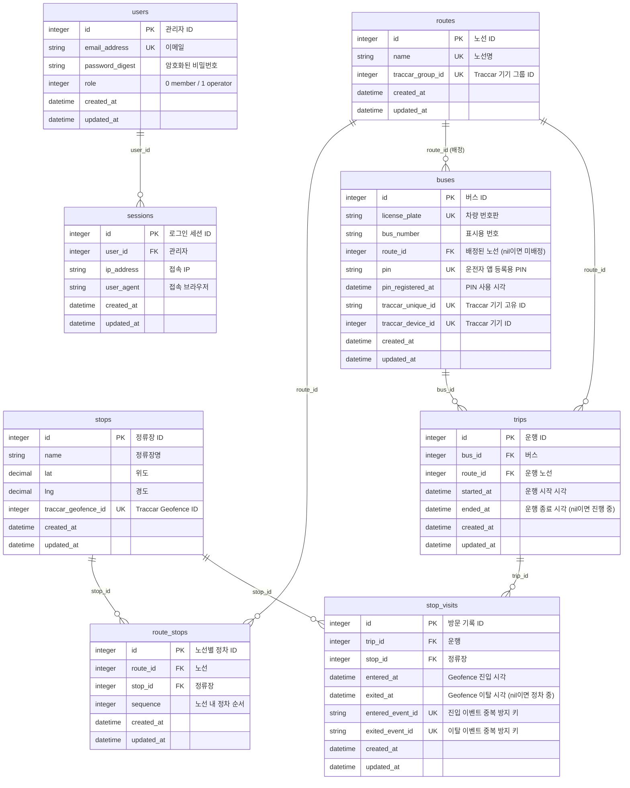

# 설계: 이벤트 기반 재작성 (로컬 데모 버전)

- 목표: `docs/product_requirements.md`의 MVP 3개를 만족하는 최소 구조로 데이터 모델을 처음부터 다시 짓고, Rails 앱과 Traccar 서버를 Docker로 로컬에서 실행한다.
- 범위: 팀원에게 로컬에서 보여주는 데모. 운영 배포, 다국어, ETA는 제외한다.
- 상태: **결정 완료, Traccar 동작 가정은 실측으로 검증 완료 (6절).**
- 기존 모델과의 전후 비교와 결정 이유는 `docs/data-model-rewrite.md`에 정리했다.
- 이번 범위에서 일부러 단순하게 둔 부분과 미룬 문제는 `docs/future-improvements.md`에 모은다.

## 1. 확정된 결정

| 항목 | 결정 |
|---|---|
| 제거 | 시·도/운행지역 계층, 좋아요, 다국어, `PinCode`, `gps_logs`, 노선-버스 N:N 배차(`route_buses`), ETA 계산 |
| 마이그레이션 | 기존 것을 모두 지우고 새 초기 스키마로 시작 |
| 정류장 | 물리적 정류장 1개를 여러 노선이 공유할 수 있음 |
| 차량-노선 | **관리자가 차량 하나에 노선 하나를 배정**한다 (`buses.route_id`, 2026-10-24 합의). 운전자는 노선을 고르지 않고 배정된 노선으로 운행한다. 차량은 노선 하나에만 배정되며 다른 노선에 배정하면 옮겨진다. 운행 중에는 배정을 바꾸거나 풀 수 없다 |
| 운행 | 운전자가 앱에서 시작·종료(노선은 배정된 것). 배정된 노선이 없으면 시작할 수 없다. 버스당 진행 중인 운행은 DB 제약으로 하나 |
| 운전자 인증 | 지금의 PIN 등록 그대로 (운전자 계정 없음) |
| Traccar 그룹 | 노선당 기기 그룹 1개. **관리자가 차량을 노선에 배정할 때** 기기를 그 노선 그룹으로 옮기고, 배정을 풀면 그룹에서 뺀다. 운행 시작·종료는 Traccar를 부르지 않는다 |
| Traccar 실패 시 | 관리자의 등록·수정·삭제·배정은 Traccar 반영이 실패하면 Rails 변경도 취소(완전 롤백). **운전자의 운행 시작·종료는 Traccar와 무관**하므로 Traccar 장애에도 동작한다 (개선점 9·10번 해소) |
| 운행 시작·종료 API 인증 | `deviceId`로 식별 (지금 방식 유지). 등록 시 별도 토큰 발급은 후속 과제 |
| 관리자 역할 | 기존 `operator`/`member` 구분 유지 (관리자 화면은 `operator`만) |
| `driver_app` | **이번 버전에서는 수정하지 않는다.** 서버 API는 앱이 쓸 수 있게 준비돼 있고(4절), 시뮬레이터가 앱의 역할을 대신한다. 앱 수정은 `docs/future-improvements.md` 21번 |

## 2. 요구사항과 설계의 대응

| 요구사항 | 설계 |
|---|---|
| 1. 관리자가 정류장을 등록하면 Traccar Geofence 자동 생성, 도착/출발을 Geofence 이벤트로 감지 | 정류장 생성 시 Geofence 생성(기존 서비스 재사용). 이벤트 수신 엔드포인트와 `stop_visits` 테이블을 새로 추가 |
| 2. 운전자가 GPS 전송 | 기존 방식 유지: `driver_app` → `traccar_client_sdk` → Traccar. Rails는 좌표를 저장하지 않음 |
| 3. 승객이 정류장 기준으로 자기 노선 버스가 어느 정류장에 있는지 조회 | 승객 화면이 노선의 진행 중인 운행과 각 운행의 최신 방문 기록을 조회 |

## 3. 데이터 모델

### 복합 제약·인덱스

| 테이블 | 종류 | 컬럼 | 의미 |
|---|---|---|---|
| `route_stops` | 유니크 | `(route_id, stop_id)` | 한 노선에 같은 정류장 중복 금지 |
| `route_stops` | 유니크 | `(route_id, sequence)` | 한 노선 안에서 정차 순서 중복 금지 (기존 모델의 결함 7번 해소) |
| `trips` | 부분 유니크 | `(bus_id)` where `ended_at` is null | 버스당 진행 중인 운행은 하나 (기존 결함 8번 해소) |
| `trips` | 일반 | `(route_id, ended_at)` | 노선별 진행 중 운행 조회용 |
| `stop_visits` | 일반 | `(trip_id, entered_at)` | 운행별 최신 방문 조회용 |

### 설계 메모

- **노선 방향**: 왕복·순환은 모델링하지 않는다. 방향이 다르면 노선을 따로 만든다(예: "1번 상행", "1번 하행"). 같은 정류장을 두 노선이 공유하므로 정류장 중복 등록은 필요 없다.
- **`stop_visits`의 이벤트 ID**: 진입과 이탈은 Traccar에서 별도 이벤트라 컬럼이 둘이다. 값은 `"<event.id>@<eventTime>"` 형식의 문자열이다 (6절).
- **`gps_logs` 제거**: 좌표 이력은 Traccar가 보관한다. 지도가 필요해지면 버스에 마지막 좌표 컬럼을 두는 식으로 추가한다.
- **`buses.status` 제거**: 활성/비활성 개념은 현재 요구사항에 없다.

## 4. 동작 흐름

### 관리자 설정

1. 노선 생성 → Traccar 기기 그룹 생성 → `routes.traccar_group_id` 저장.
2. 정류장 생성 → Traccar Geofence 생성(정류장 중심 30m 정사각형, 기존 서비스) → `stops.traccar_geofence_id` 저장.
3. 노선에 정류장 추가·제거(`route_stops`) → 그 Geofence를 노선 그룹에 연결·해제. 한 정류장이 여러 노선에 속하면 Geofence 하나를 여러 그룹에 연결한다.
4. 버스 생성 → `traccar_unique_id`·PIN 자동 발급 → Traccar 기기 생성 → `traccar_device_id` 저장. 노선을 함께 배정하면 기기를 그 노선 그룹으로 옮긴다.
5. 차량에 노선 배정·변경·해제(노선 화면 또는 차량 화면) → Traccar 기기를 새 노선 그룹으로 옮기거나 그룹에서 뺀다. 운행 중인 차량은 거부한다.
6. 위 변경은 모두 Traccar 호출이 실패하면 Rails도 롤백한다 (기존 정책).

### 운전자 (driver_app) — 앱 화면 수정은 이번 범위 밖이며 시뮬레이터가 같은 호출을 대신한다

1. 최초 1회: PIN 등록 → `traccarServerUrl`, `deviceId`와 **배정된 노선**(없으면 `null`) 수신.
2. 운행 시작: 시작 요청 → Rails가 차량에 배정된 노선으로 운행을 만든다. 노선을 고르지 않으며, 배정된 노선이 없으면 `422`. Traccar를 부르지 않는다.
3. 운행 중: `traccar_client_sdk`가 Traccar로 GPS를 전송 (기존 방식). 기기는 배정 때 이미 그 노선의 그룹에 들어 있다.
4. 운행 종료: 운행을 닫고 열린 방문 기록도 종료 시각으로 닫는다. Traccar를 부르지 않는다.

### 이벤트 수신

1. Traccar가 Geofence 진입·이탈 이벤트를 Rails로 포워딩 (`X-Ingest-Token` 인증).
2. Rails는 `device.uniqueId`로 버스를, `event.geofenceId`로 정류장을 찾고 그 버스의 진행 중인 운행을 조회한다. `event.type`이 `geofenceEnter`·`geofenceExit`가 아니면 무시한다.
3. 아래 경우는 기록하지 않고 로그만 남긴다: 알 수 없는 기기·Geofence, 진행 중인 운행 없음, 정류장이 운행 노선에 속하지 않음.
4. 진입이면 방문 기록을 만들고, 이탈이면 같은 운행·정류장의 열린 방문 기록을 닫는다. 기록 시각은 `event.eventTime`(위치의 측정 시각)을 쓴다. 중복 방지 키는 `event.id`와 `eventTime`을 합친 값이다 (Traccar DB가 초기화되면 ID가 1부터 다시 시작해 ID만으로는 충돌하기 때문). 키가 이미 있으면 무시한다.

### 승객 화면

1. 노선 선택 → 정류장 선택.
2. 선택한 노선의 진행 중인 운행마다 최신 방문 기록으로 상태를 계산한다.
   - 이탈 시각이 없으면 "OO 정류장 정차 중".
   - 이탈 시각이 있으면 "OO 정류장 출발, 다음은 OO".
   - 선택한 정류장까지 남은 정거장 수는 `route_stops.sequence` 차이로 계산한다.
3. 운행 중인 버스가 없으면 "운행 중인 버스 없음".

### 운전자 앱·Traccar 연동 API

모두 `ActionController::API` 기반의 머신 간 엔드포인트다. 운전자 앱은 `deviceId`(= `buses.traccar_unique_id`)로 버스를 식별한다 (기기별 토큰은 후속 과제, `docs/future-improvements.md` 2번).

| 메서드·경로 | 호출자 | 요청 | 응답 |
|---|---|---|---|
| `POST /integrations/traccar/register` | 앱 (최초 1회) | `pin` | `200 { traccarServerUrl, deviceId, busNumber, licensePlate, route }`. `route`는 배정된 노선 `{ id, name, stops: [{ name, lat, lng }] }`이고 미배정이면 `null`. 잘못된 PIN `401`, 사용된 PIN `409`, 시도 초과 `429` |
| `GET /integrations/traccar/bus` | 앱 (메인 화면) | `deviceId` | `200 { busNumber, licensePlate, route, activeTrip }`. `activeTrip`은 진행 중인 운행이 없으면 `null`. 알 수 없는 기기 `404` |
| `POST /integrations/traccar/trips/start` | 앱 | `deviceId` | `200 { trip: { id, routeId, routeName, startedAt } }`. 이미 운행 중이면 같은 응답(멱등). 배정된 노선이 없으면 `422 { error: "no_route_assigned" }`. 알 수 없는 기기 `404`. 노선은 서버가 정하므로 `routeId`를 보내도 무시한다 |
| `POST /integrations/traccar/trips/end` | 앱 | `deviceId` | `200 { ended: true\|false }`. 진행 중인 운행이 없어도 `200`(멱등) |
| `POST /integrations/traccar/events` | Traccar 서버 | Traccar 이벤트 JSON (`X-Ingest-Token`) | `200 { status: "recorded"\|"ignored", reason? }`. 토큰 오류 `401` |

기존 `POST /integrations/traccar/positions`(위치 수신)는 제거했다. 앱의 GPS는 Traccar로 직접 전송되고 Rails는 좌표를 저장하지 않는다. 앱에 대한 변경점: 옛 `routes`(전체 노선 목록, `nextStop`)는 `bus`(이 차량의 배정 노선)로 바뀌었고, 운행 시작에서 노선 선택이 사라졌다.

## 5. Docker 구성

- `docker-compose` 서비스 두 개:
  - `rails`: 개발용 이미지(소스 마운트, SQLite는 볼륨), 포트 3000.
  - `traccar`: 공식 이미지 `traccar/traccar:6`, 포트 8082(웹·API)와 5055(OsmAnd 수신)만 공개. H2 DB.
- `traccar.xml` 마운트:
  - `event.forward.url`을 Rails 컨테이너 주소(`http://rails:3000/integrations/traccar/events`)로 지정.
  - `event.forward.header`로 인증 토큰 전달.
  - `web.serviceAccountToken`으로 Rails용 API 토큰 지정(별도 계정 생성 단계 생략).
- Rails → Traccar API는 `http://traccar:8082` 사용. 접속 정보는 환경변수로 받는다.
- 기존 운영용 `Dockerfile`은 건드리지 않고 개발용 설정을 별도 파일로 둔다.
- 시뮬레이터: 스크립트가 지정한 버스(`demo:drive[1번]`)의 배정 노선 정류장 좌표를 Traccar 5055 포트로 순서대로 보내 운행을 재현한다. 운행 시작·종료는 같은 스크립트가 API로 호출한다.
- 시드: 노선 1~2개, 정류장 5~6개(한 정류장은 두 노선 공유), 버스 2대, `operator` 계정 1개.

## 6. Traccar 동작 검증 결과

`traccar/traccar:6` 이미지(Docker)를 띄워 실제로 확인했다 (2026-10-23). 실험은 임시 환경에서 했고, 스크립트는 7단계의 compose·시뮬레이터에 반영한다.

| # | 가정 | 결과 |
|---|---|---|
| 1 | 이벤트 페이로드 형식 | 확인. 아래 표 |
| 2 | `web.serviceAccountToken`으로 API 호출 | 확인. `Authorization: Bearer <토큰>`으로 `/api/*`가 호출되고 사용자 생성이 필요 없다. 단 `/api/reports/*`는 이 토큰으로 결과가 비어 있다 (앱은 쓰지 않음). 현재 `TraccarApiClient`는 기본 인증만 지원하므로 토큰 방식 추가가 필요하다 (7단계) |
| 3 | 기기 그룹 이동이 즉시 반영 | 확인. `groupId`를 0으로 바꾸면 이벤트가 끊기고, 다시 넣으면 바로 다음 위치부터 이벤트가 온다 |
| 4 | 30m Geofence 판정 | 확인. 80m 간격 좌표로 접근해 안으로 들어가면 진입 1건, 나가면 이탈 1건. 안에서 9m 움직인 위치는 이벤트가 없다 |
| 5 | 권한 연결·해제 API | 확인. `POST /api/permissions`는 같은 쌍을 다시 보내도 `204`(오류 아님), `DELETE /api/permissions`는 JSON 본문을 받아 `204`로 해제하며 해제 후 이벤트가 끊기고 재연결하면 재개된다 |

### 이벤트 페이로드 (`event.forward`, JSON)

`event.forward.header`에 적은 값이 요청 헤더로 그대로 전달된다 (예: `X-Ingest-Token`). 본문은 `event`, `position`, `device`, `geofence` 네 객체다.

| 필드 | 의미 | 사용 |
|---|---|---|
| `event.id` | Traccar DB의 이벤트 ID (정수, 증가) | 중복 방지 키의 일부 |
| `event.type` | `geofenceEnter` / `geofenceExit` | 둘 외에는 무시 |
| `event.eventTime` | 위치의 측정 시각 (UTC, ISO 8601) | `entered_at`·`exited_at`, 중복 방지 키의 일부 |
| `event.geofenceId` | Geofence ID | `stops.traccar_geofence_id`로 정류장 조회 |
| `event.deviceId`, `device.id` | Traccar 기기 ID | 참고용 |
| `device.uniqueId` | 기기 고유 ID | `buses.traccar_unique_id`로 버스 조회 |
| `device.groupId` | 기기의 현재 그룹 ID | 노선 그룹과 일치하는지 교차 검증에 사용 가능 |
| `position.geofenceIds` | 그 위치가 속한 Geofence 목록 (이탈 시 `null`) | 참고용 |

### 운영상 알게 된 점

- **위치 시각이 뒤로 가면 이벤트가 만들어지지 않는다.** 직전 위치보다 과거 시각의 위치는 건너뛴 것으로 관측됐다. 시뮬레이터는 시각을 항상 앞으로만 보내야 한다. 실제 기기가 오프라인 상태에서 쌓아 둔 위치를 늦게 보내면 그 이벤트를 놓칠 수 있다 (`docs/future-improvements.md` 18번).
- **이벤트 ID는 Traccar DB가 초기화되면 1부터 다시 시작한다.** Rails DB는 그대로인데 Traccar만 초기화하면 ID가 충돌하므로, 중복 방지 키를 ID와 시각의 조합으로 정했다 (19번).
- **필터링은 Rails의 몫이다.** Traccar는 `geofenceEnter`·`geofenceExit` 외의 이벤트도 같은 주소로 보낼 수 있다. 이번 실험에서는 두 종류만 관측됐다.

## 7. 구현 순서

1~7은 완료했다. 8은 이번 범위에서 제외하고 개선점 문서로 옮겼다.

1. 새 스키마와 모델 (기존 마이그레이션·모델·불필요한 컨트롤러와 화면 제거).
2. Traccar 동기화 서비스 수정 (그룹 이동 추가, 배차 연동 제거).
3. 이벤트 수신 엔드포인트와 방문 기록 (미검증 가정 1 확인 포함).
4. 운행 시작·종료 API (이후 차량-노선 고정 배정으로 변경: 노선 선택 제거, 배정 때 Traccar 그룹 이동).
5. 관리자 화면 정리 (노선·정류장·노선별 정차·버스).
6. 승객 화면.
7. `docker-compose`, `traccar.xml`, 시드, 시뮬레이터 (미검증 가정 2~4 확인).
8. ~~`driver_app` 화면 수정~~ — 범위 밖 (`docs/future-improvements.md` 21번).
