# 설계: 이벤트 기반 재작성 (로컬 데모 버전)

- 목표: `docs/product_requirements.md`의 MVP 3개를 만족하는 최소 구조로 데이터 모델을 처음부터 다시 짓고, Rails 앱과 Traccar 서버를 Docker로 로컬에서 실행한다.
- 범위: 팀원에게 로컬에서 보여주는 데모. 운영 배포, 다국어, ETA는 제외한다.
- 상태: **결정 완료, 미검증 가정은 구현 첫 단계에서 확인.**
- 이번 범위에서 일부러 단순하게 둔 부분과 미룬 문제는 `docs/future-improvements.md`에 모은다.

## 1. 확정된 결정

| 항목 | 결정 |
|---|---|
| 제거 | 시·도/운행지역 계층, 좋아요, 다국어, `PinCode`, `gps_logs`, 노선-버스 배차(`route_buses`), ETA 계산 |
| 마이그레이션 | 기존 것을 모두 지우고 새 초기 스키마로 시작 |
| 정류장 | 물리적 정류장 1개를 여러 노선이 공유할 수 있음 |
| 운행 | 운전자가 앱에서 노선을 골라 시작·종료. 버스당 진행 중인 운행은 DB 제약으로 하나 |
| 운전자 인증 | 지금의 PIN 등록 그대로 (운전자 계정 없음) |
| Traccar 그룹 | 노선당 기기 그룹 1개. 운행 시작에 기기를 그 노선 그룹으로 이동, 종료에 해제 |
| Traccar 실패 시 | 기존 정책대로 Rails 변경도 하지 않음 (운행 시작 실패). 단 **운행 종료는 예외**: Rails에서 먼저 닫고 Traccar 그룹 해제 실패는 로그만 남김 (남은 그룹 소속은 다음 운행 시작 때 덮어써지고, 그 사이 이벤트는 진행 중인 운행이 없어 무시됨) |
| 운행 시작·종료 API 인증 | `deviceId`로 식별 (지금 방식 유지). 등록 시 별도 토큰 발급은 후속 과제 |
| 관리자 역할 | 기존 `operator`/`member` 구분 유지 (관리자 화면은 `operator`만) |
| `driver_app` | 노선 선택과 시작·종료 화면을 이번 버전에 포함 |

## 2. 요구사항과 설계의 대응

| 요구사항 | 설계 |
|---|---|
| 1. 관리자가 정류장을 등록하면 Traccar Geofence 자동 생성, 도착/출발을 Geofence 이벤트로 감지 | 정류장 생성 시 Geofence 생성(기존 서비스 재사용). 이벤트 수신 엔드포인트와 `stop_visits` 테이블을 새로 추가 |
| 2. 운전자가 GPS 전송 | 기존 방식 유지: `driver_app` → `traccar_client_sdk` → Traccar. Rails는 좌표를 저장하지 않음 |
| 3. 승객이 정류장 기준으로 자기 노선 버스가 어느 정류장에 있는지 조회 | 승객 화면이 노선의 진행 중인 운행과 각 운행의 최신 방문 기록을 조회 |

## 3. 데이터 모델

```mermaid
erDiagram
    routes ||--o{ route_stops : "route_id"
    stops  ||--o{ route_stops : "stop_id"
    buses  ||--o{ trips : "bus_id"
    routes ||--o{ trips : "route_id"
    trips  ||--o{ stop_visits : "trip_id"
    stops  ||--o{ stop_visits : "stop_id"
    users  ||--o{ sessions : "user_id"

    routes {
        integer id PK "노선 ID"
        string name UK "노선명"
        integer traccar_group_id UK "Traccar 기기 그룹 ID"
        datetime created_at
        datetime updated_at
    }
    stops {
        integer id PK "정류장 ID"
        string name "정류장명"
        decimal lat "위도"
        decimal lng "경도"
        integer traccar_geofence_id UK "Traccar Geofence ID"
        datetime created_at
        datetime updated_at
    }
    route_stops {
        integer id PK "노선별 정차 ID"
        integer route_id FK "노선"
        integer stop_id FK "정류장"
        integer sequence "노선 내 정차 순서"
        datetime created_at
        datetime updated_at
    }
    buses {
        integer id PK "버스 ID"
        string license_plate UK "차량 번호판"
        string bus_number "표시용 번호"
        string pin UK "운전자 앱 등록용 PIN"
        datetime pin_registered_at "PIN 사용 시각"
        string traccar_unique_id UK "Traccar 기기 고유 ID"
        integer traccar_device_id UK "Traccar 기기 ID"
        datetime created_at
        datetime updated_at
    }
    trips {
        integer id PK "운행 ID"
        integer bus_id FK "버스"
        integer route_id FK "운행 노선"
        datetime started_at "운행 시작 시각"
        datetime ended_at "운행 종료 시각 (nil이면 진행 중)"
        datetime created_at
        datetime updated_at
    }
    stop_visits {
        integer id PK "방문 기록 ID"
        integer trip_id FK "운행"
        integer stop_id FK "정류장"
        datetime entered_at "Geofence 진입 시각"
        datetime exited_at "Geofence 이탈 시각 (nil이면 정차 중)"
        string entered_event_id UK "진입 이벤트 중복 방지 키"
        string exited_event_id UK "이탈 이벤트 중복 방지 키"
        datetime created_at
        datetime updated_at
    }
    users {
        integer id PK "관리자 ID"
        string email_address UK "이메일"
        string password_digest "암호화된 비밀번호"
        integer role "0 member / 1 operator"
        datetime created_at
        datetime updated_at
    }
    sessions {
        integer id PK "로그인 세션 ID"
        integer user_id FK "관리자"
        string ip_address "접속 IP"
        string user_agent "접속 브라우저"
        datetime created_at
        datetime updated_at
    }
```

### 복합 제약·인덱스

| 테이블 | 종류 | 컬럼 | 의미 |
|---|---|---|---|
| `route_stops` | 유니크 | `(route_id, stop_id)` | 한 노선에 같은 정류장 중복 금지 |
| `route_stops` | 유니크 | `(route_id, sequence)` | 한 노선 안에서 정차 순서 중복 금지 (기존 모델의 결함 7번 해소) |
| `trips` | 부분 유니크 | `(bus_id)` where `ended_at` is null | 버스당 진행 중인 운행은 하나 (기존 결함 8번 해소) |
| `trips` | 일반 | `(route_id, ended_at)` | 노선별 진행 중 운행 조회용 |
| `stop_visits` | 일반 | `(trip_id, entered_at)` | 운행별 최신 방문 조회용 |

### 설계 메모

- **노선 방향**: 왕복·순환은 모델링하지 않는다. 방향이 다르면 노선을 따로 만든다(예: "1번 상행", "1번 하행"). 같은 정류장을 두 노선이 공유하므로 정류장 중복 등록은 필요 없다.
- **`stop_visits`의 이벤트 ID**: 진입과 이탈은 Traccar에서 별도 이벤트라 ID 컬럼이 둘이다. 실제 이벤트 페이로드를 받아 필드를 확인한 뒤 확정한다(4절 미검증 가정 1).
- **`gps_logs` 제거**: 좌표 이력은 Traccar가 보관한다. 지도가 필요해지면 버스에 마지막 좌표 컬럼을 두는 식으로 추가한다.
- **`buses.status` 제거**: 활성/비활성 개념은 현재 요구사항에 없다.

## 4. 동작 흐름

### 관리자 설정

1. 노선 생성 → Traccar 기기 그룹 생성 → `routes.traccar_group_id` 저장.
2. 정류장 생성 → Traccar Geofence 생성(정류장 중심 30m 정사각형, 기존 서비스) → `stops.traccar_geofence_id` 저장.
3. 노선에 정류장 추가·제거(`route_stops`) → 그 Geofence를 노선 그룹에 연결·해제. 한 정류장이 여러 노선에 속하면 Geofence 하나를 여러 그룹에 연결한다.
4. 버스 생성 → `traccar_unique_id`·PIN 자동 발급 → Traccar 기기 생성 → `traccar_device_id` 저장.
5. 위 변경은 모두 Traccar 호출이 실패하면 Rails도 롤백한다 (기존 정책).

### 운전자 (driver_app)

1. 최초 1회: PIN 등록 → `traccarServerUrl`, `deviceId` 수신 (기존 API 유지).
2. 운행 시작: 전체 노선 목록 조회 → 노선 선택 → 시작 요청. Rails는 한 트랜잭션에서 운행을 만들고 Traccar 기기를 해당 노선 그룹으로 옮긴다. 실패하면 둘 다 취소한다.
3. 운행 중: `traccar_client_sdk`가 Traccar로 GPS를 전송 (기존 방식).
4. 운행 종료: 운행을 먼저 닫고 기기를 그룹에서 뺀다. 그룹 해제가 실패해도 종료는 성공으로 처리하고 로그만 남긴다.

### 이벤트 수신

1. Traccar가 Geofence 진입·이탈 이벤트를 Rails로 포워딩 (`X-Ingest-Token` 인증).
2. Rails는 기기 → 버스, Geofence → 정류장을 찾고 그 버스의 진행 중인 운행을 조회한다.
3. 아래 경우는 기록하지 않고 로그만 남긴다: 알 수 없는 기기·Geofence, 진행 중인 운행 없음, 정류장이 운행 노선에 속하지 않음.
4. 진입이면 방문 기록을 만들고, 이탈이면 같은 운행·정류장의 열린 방문 기록을 닫는다. 이벤트 ID가 이미 있으면 무시한다.

### 승객 화면

1. 노선 선택 → 정류장 선택.
2. 선택한 노선의 진행 중인 운행마다 최신 방문 기록으로 상태를 계산한다.
   - 이탈 시각이 없으면 "OO 정류장 정차 중".
   - 이탈 시각이 있으면 "OO 정류장 출발, 다음은 OO".
   - 선택한 정류장까지 남은 정거장 수는 `route_stops.sequence` 차이로 계산한다.
3. 운행 중인 버스가 없으면 "운행 중인 버스 없음".

## 5. Docker 구성

- `docker-compose` 서비스 두 개:
  - `rails`: 개발용 이미지(소스 마운트, SQLite는 볼륨), 포트 3000.
  - `traccar`: 공식 이미지 `traccar/traccar:6`, 포트 8082(웹·API)와 5055(OsmAnd 수신)만 공개. H2 DB.
- `traccar.xml` 마운트:
  - `event.forward.url`을 Rails 컨테이너 주소(`http://rails:3000/integrations/traccar/events`)로 지정.
  - `event.forward.header`로 인증 토큰 전달.
  - `web.serviceAccountToken`으로 Rails용 API 토큰 지정(별도 계정 생성 단계 생략).
- Rails → Traccar API는 `http://traccar:8082` 사용. 접속 정보는 환경변수로 받는다.
- 기존 운영용 `Dockerfile`은 건드리지 않고 개발용 설정을 별도 파일로 둔다.
- 시뮬레이터: 스크립트가 지정한 버스 ID로 Traccar 5055 포트에 정류장 좌표를 순서대로 보내 운행을 재현한다. 운행 시작·종료는 같은 스크립트가 API로 호출한다.
- 시드: 노선 1~2개, 정류장 5~6개(한 정류장은 두 노선 공유), 버스 2대, `operator` 계정 1개.

## 6. 미검증 가정 (구현 첫 단계에서 확인)

1. **이벤트 페이로드**: 공식 문서에는 `event.forward` JSON의 필드 구성이 없다. 실제 이벤트를 받아서 이벤트 ID, 기기 ID, Geofence ID의 필드명을 확인한다.
2. **`web.serviceAccountToken`**: 이 토큰으로 `/api/*` 호출이 되는지 확인한다. 안 되면 첫 관리자 계정을 API로 만드는 초기화 단계를 둔다.
3. **그룹 이동 시점**: 기기의 `groupId`를 바꾼 직후부터 새 그룹의 Geofence 이벤트가 오는지 확인한다.
4. **Geofence 판정**: 시뮬레이터가 보내는 좌표 간격에서 30m Geofence 진입·이탈이 안정적으로 발생하는지 확인한다.
5. **권한 연결·해제 API**: `POST /api/permissions`로 이미 연결된 쌍을 다시 연결하면 어떻게 응답하는지, `DELETE /api/permissions`가 요청 본문(JSON)을 받아 해제하는지 확인한다. 둘 다 `TraccarRouteStopLink`가 전제한다.

## 7. 구현 순서

1. 새 스키마와 모델 (기존 마이그레이션·모델·불필요한 컨트롤러와 화면 제거).
2. Traccar 동기화 서비스 수정 (그룹 이동 추가, 배차 연동 제거).
3. 이벤트 수신 엔드포인트와 방문 기록 (미검증 가정 1 확인 포함).
4. 운행 시작·종료 API.
5. 관리자 화면 정리 (노선·정류장·노선별 정차·버스).
6. 승객 화면.
7. `docker-compose`, `traccar.xml`, 시드, 시뮬레이터 (미검증 가정 2~4 확인).
8. `driver_app` 화면 수정.
