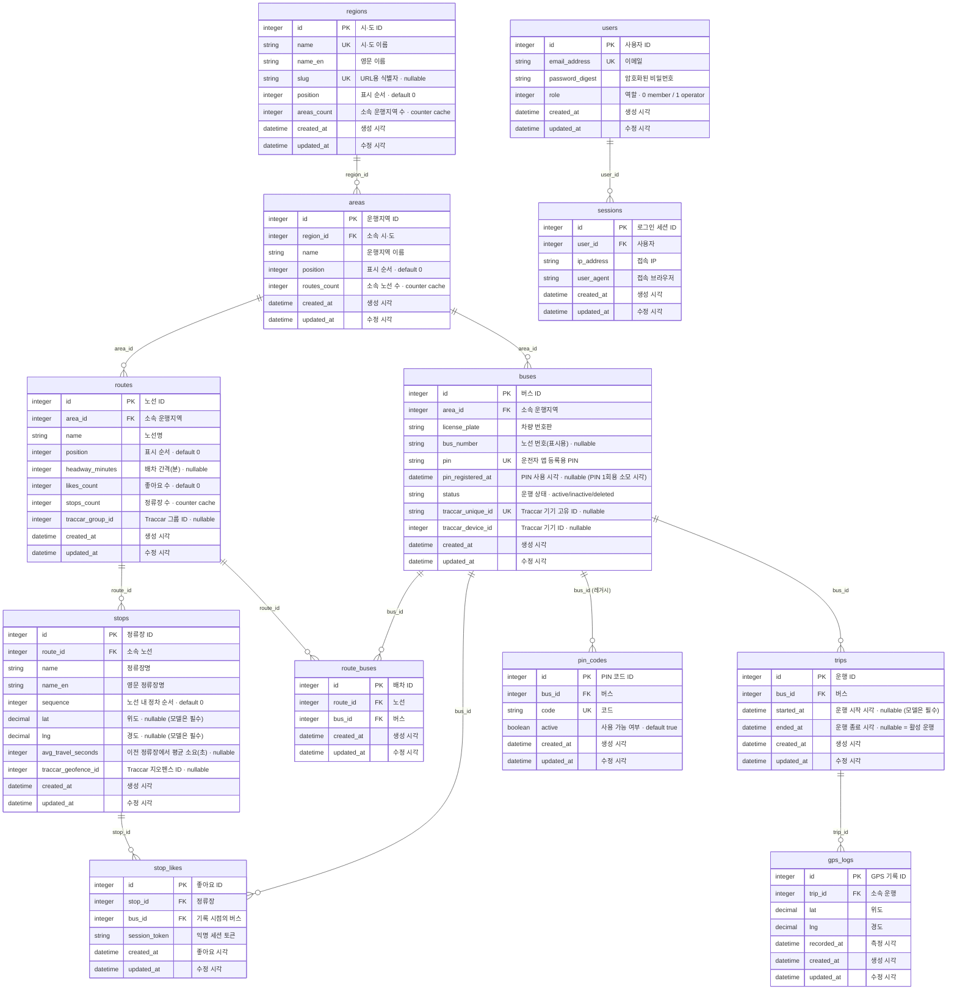

# ERD (origin/main 기준)

- 기준 커밋: `b43993d` (2026-09-18, PR #19 머지), 스키마 버전 `2026_09_18_092145`
- 정보원: `db/schema.rb` (컬럼·인덱스·FK), `app/models/*.rb` (연관관계·검증·`dependent`·`default_scope`)
- 제외: Solid Queue·Cache·Cable 인프라 테이블 (`queue_schema.rb` 등)

## 구조 요약

- **지역 계층**: `Region → Area → Route → Stop`. `Area` 아래에는 `Bus`도 속한다.
- **노선·버스 배차**: `Route`와 `Bus`는 `RouteBus`를 통한 N:N.
- **운행 기록**: `Bus → Trip → GpsLog`. `ended_at`이 nil인 `Trip`이 활성 운행.
- **승객 상호작용**: `StopLike`가 `Stop`과 `Bus`를 함께 참조하며, 로그인 없이 `session_token`으로 식별한다.
- **인증**: `User → Session`은 위 도메인과 FK로 연결되지 않은 별도 영역.
- **레거시**: `PinCode`는 `Bus`에 연결돼 있지만 현재 인증에는 `Bus.pin`이 쓰인다.

## ERD

## 복합 유니크 제약·인덱스

단일 컬럼 유니크(`UK`)는 ERD의 키 칸에 표시했다. 여러 컬럼에 걸친 제약과 인덱스는 Mermaid로 표현할 수 없어 아래에 따로 적는다. 각 외래키 컬럼에는 단일 컬럼 인덱스도 하나씩 있으나 생략했다.

| 테이블 | 종류 | 컬럼 | 의미 |
|---|---|---|---|
| `areas` | 유니크 | `(region_id, name)` | 한 시·도 안에서 운행지역명 중복 금지 |
| `routes` | 유니크 | `(area_id, name)` | 한 운행지역 안에서 노선명 중복 금지 |
| `buses` | 유니크 | `(area_id, license_plate)` | 한 운행지역 안에서 번호판 중복 금지 |
| `route_buses` | 유니크 | `(route_id, bus_id)` | 같은 버스를 같은 노선에 중복 배정 금지 |
| `stops` | 일반 | `(route_id, sequence)` | 노선별 정차 순서 조회용. **유니크 아님** |
| `trips` | 일반 | `(bus_id, ended_at)` | 버스별 활성 운행(`ended_at` nil) 조회용. **유니크 아님** |
| `gps_logs` | 일반 | `(trip_id, recorded_at)` | 운행별 최신 GPS 조회용 |
| `stop_likes` | 일반 | `(session_token, stop_id)` | 세션별 좋아요 조회용. **유니크 아님** |
| `stop_likes` | 일반 | `(stop_id, bus_id, session_token)` | 정류장·버스·세션 조회용. **유니크 아님** |
| `stop_likes` | 일반 | `(stop_id, session_token, created_at)` | "1시간 내 중복" 검사용. **유니크 아님** |

## 모델 수준 규칙 (스키마에는 없는 것)

| 구분 | 내용 |
|---|---|
| `default_scope` | `Region`·`Area`·`Route`는 `position, name`순, `Stop`은 `sequence`순, `Bus`는 `license_plate`순 |
| 삭제 전파 (`dependent: :destroy`) | `Region→Area→(Route, Bus)`, `Route→(Stop, RouteBus)`, `Bus→(RouteBus, Trip, PinCode)`, `Trip→GpsLog`, `User→Session` |
| 삭제 전파 없음 | `StopLike` (`Stop`·`Bus` 어느 쪽에도 `has_many :stop_likes` 없음, DB에는 FK 있음) |
| counter cache | `Region.areas_count`, `Area.routes_count`, `Route.stops_count`. `Route.likes_count`는 컬럼만 있고 `counter_cache` 선언 없음 |
| 검증 | `Bus.pin`은 4~6자리 숫자 + 전역 유니크, `Stop.sequence`는 1 이상 정수, `Stop.lat/lng`·`Trip.started_at`은 모델에서 필수 (DB는 nullable) |
| 자동 생성 | `Bus` 생성 시 `pin`, `traccar_unique_id` 자동 발급 (`before_validation on: :create`) |
| 역할 | `User` 첫 가입자는 `operator` (`before_create`) |
