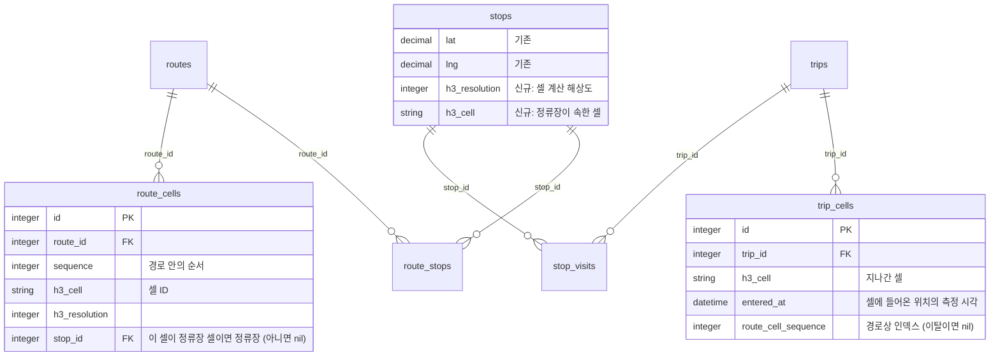
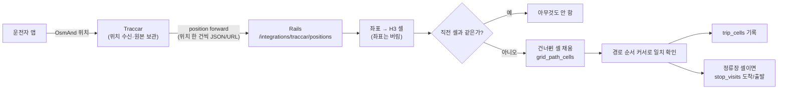

# 제안: H3 공간 인덱스로 버스 경로와 정류장 관리 (검토용)

- 상태: **제안. 결정된 것이 없다.** 현재 방식(정류장별 Traccar Geofence)과 나란히 비교해 팀이 고르기 위한 문서다.
- 이 문서는 기존 설계 문서(`design-event-driven-rewrite.md`, `traccar-integration.md`)를 고치지 않는다. 채택하면 그때 그 문서들을 바꾼다.
- 숫자는 실제로 계산한 것(4절, 부록)과 아직 확인하지 못한 것(`확인 필요`)을 구분해 적었다.

## 1. 한 줄 요약과 결정 요청

**정류장마다 Geofence를 만들어 Traccar가 도착·출발을 판정하는 대신, 지도를 H3 육각형 셀로 나눠 노선 경로와 정류장을 셀로 관리하고, 버스가 지나간 셀의 순서로 "어느 정류장에 있는지"를 Rails가 판정한다.**

검토해 줄 것:

1. 이 방향이 현재 방식보다 나은가, 아니면 검증 실험만 할 가치가 있는가 (9절의 shadow 방식을 제안한다).
2. 해상도를 어떻게 둘 것인가. 레벨 9는 이 데모 좌표에서 정류장 6곳을 모두 구분하지만 여유가 거의 없다 (4절).
3. 위치를 Rails가 받는 방식 (5절). 이 선택이 가장 크게 구조를 바꾼다.

## 2. 현재 방식과 제안의 비교

| 항목 | 현재: 정류장별 Geofence | 제안: H3 셀 |
|---|---|---|
| 정류장 표현 | 정류장마다 30m 정사각형 Geofence (`stops.traccar_geofence_id`) | 정류장이 속한 셀 (`stops`의 셀 컬럼, 아래 3절) |
| 노선 표현 | 노선당 Traccar 기기 그룹 + 그룹↔Geofence 권한 | 노선 경로를 셀의 순서 목록으로 저장 (`route_cells`) |
| 판정 위치 | Traccar가 판정, Rails는 이벤트만 받음 | Rails가 위치를 받아 셀로 바꾸고 판정 (5절의 방식에 따라 앱이 할 수도 있음) |
| Rails가 받는 것 | `geofenceEnter`·`geofenceExit` 이벤트 | 위치(좌표 → 셀 변환 직후 좌표는 버림) 또는 앱이 계산한 셀 |
| 버스 이동 경로 | 없음(방문 기록 `stop_visits`만) | 지나간 셀의 이력 (`trip_cells`). 좌표는 저장하지 않음 |
| Traccar와 동기화 | 정류장·노선·차량 등록 때 Traccar API 호출과 한 트랜잭션 (`*Registration`) | 정류장·노선 쪽 호출이 사라짐. 차량(device) 등록은 남음 (5절 (a)안 기준) |
| 정확도 | 영역 30m. 시뮬레이터에서 15m/10초 설정으로 40/40 (`location-sampling-test.md`) | 해상도에 따름. 셀이 클수록 도착·출발이 정류장보다 일찍 잡힘 (4절) |
| 노선 이탈 감지 | 없음 | 경로 셀 밖이면 감지 가능 |
| ETA·이동 속도 | 없음 (`AGENTS.md` 함정 1) | 셀 통과 시간 이력으로 후속 구현 가능(이번 제안 범위 밖) |
| 늦게 도착한 위치 | 이벤트 손실 (`future-improvements.md` 18번) | 시각순 재처리로 건너뛴 정류장을 채울 수 있음 (7절. 단 `확인 필요`) |
| 운영 부담 | Geofence 수 = 정류장 수. Traccar와 Rails 자원이 어긋나면 `sync_*`로 복구 | Traccar 자원 정합성 문제가 줄어듦. 대신 위치 수신 경로와 H3 라이브러리가 새 의존성 |

## 3. 제안 설계

### 3.1 개념

[H3](https://h3geo.org/)는 지구를 육각형 셀로 나누고 셀마다 64비트 정수 ID를 주는 격자다. 해상도(0~15)가 클수록 셀이 작고, 한 셀의 부모 셀(`cell_to_parent`)은 한 단계 낮은 해상도에서 바로 구할 수 있다. **해상도는 설정값 하나(`H3_RESOLUTION`)로 두고 코드에 박지 않는다** — 바뀔 수 있다고 했으므로 모든 저장값에 해상도를 함께 남긴다.

- 좌표 → 셀: 한 번의 함수 호출이고 DB 질의가 필요 없다.
- 셀 → 이웃 셀(`grid_disk`), 두 셀 사이의 셀 목록(`grid_path_cells`)도 계산으로 구한다.
- SQLite에는 H3 기능이 없다. 셀 ID는 정수(부호 있는 64비트에 들어간다)나 16진 문자열로 저장하고 조회는 일반 인덱스를 쓴다.

### 3.2 경로와 정류장 관리

- **정류장**: 정류장 좌표가 속한 셀을 저장한다. 해상도를 바꿀 수 있도록 좌표(`stops.lat`, `lng`)는 그대로 두고 셀은 파생값으로 다시 계산할 수 있게 한다.
- **노선 경로**: 노선에 정차 순서(`route_stops.sequence`)가 이미 있다. 그 순서대로 정류장 사이를 셀로 채운 목록이 노선 경로다. 경로를 만드는 방법은 선택지가 있다 (8절 질문 3):
  1. 정류장 사이를 직선으로 이어 `grid_path_cells`로 채운다 (구현 가장 쉬움, 굽은 길은 실제와 다를 수 있음).
  2. 기준 운행을 한 번 달린 이동 셀을 기록해 경로로 삼는다.
  3. 도로 선(폴리라인)을 가져와 셀로 변환한다 (외부 데이터 필요).
- 경로 셀은 **정차 순서가 있는 목록**이라 "지금 몇 번째 정류장 구간"인지가 셀 위치로 바로 나온다.

### 3.3 버스 이동 경로

운행(`trips`)마다 지나간 셀을 시간순으로 쌓는다. 같은 셀에 머무는 동안은 쓰지 않고 **셀이 바뀔 때만** 한 줄을 쓴다.

- 위치 좌표는 저장하지 않는다. 셀 ID와 시각만 남으므로 "Rails는 GPS를 저장하지 않는다"는 원칙은 좌표 기준으로는 유지된다. 다만 셀 이력도 이동 경로이므로 보관 기간과 개인정보 관점은 정해야 한다 (8절 질문 6).
- 이 이력이 정류장 방문(`stop_visits`)의 근거가 된다. 방문 기록 테이블을 그대로 쓰고 채우는 방식만 바뀔 수도 있다 (6절).

### 3.4 판정 규칙(안)

1. **위치 → 셀**. 새 셀이 직전 셀과 같으면 아무것도 하지 않는다.
2. **샘플 사이 건너뜀 보정**. 두 샘플 사이에 셀이 둘 이상 떨어져 있으면 `grid_path_cells`로 사이 셀을 채워 순서대로 처리한다. 앱 설정이 15m/10초이므로 72km/h면 샘플 간격이 약 200m이고, 해상도가 높을수록 한 샘플에 여러 셀을 건너뛴다 (4절 표).
3. **경계 흔들림(hysteresis)**. GPS 오차로 두 셀의 경계에서 A→B→A→B로 튀면 방문이 여러 번 생긴다. 정류장 셀의 진입은 "연속 N번 같은 셀" 또는 "셀 안쪽으로 일정 시간"일 때 확정하는 식의 완충이 필요하다. 값은 실측으로 정한다.
4. **정류장 판정**. 버스가 정류장 셀에 들어가면 도착(`entered_at`), 나가면 출발(`exited_at`)로 `stop_visits`를 채운다 — 지금의 도착·출발 의미를 유지한다.
5. **순서 커서**. 운행마다 "경로상의 현재 위치(경로 목록의 인덱스)"를 갖고, 다음 N개 셀 안에서만 일치를 인정한다. 같은 길을 두 번 지나는 노선(순환·회차)에서 같은 셀이 경로에 두 번 나와도 모호하지 않게 하는 장치다.
6. **경로 이탈**. 경로 셀과 그 이웃 `k`칸에도 없으면 이탈로 표시한다(표시만 하고 방문 기록은 만들지 않음, 이번 제안은 이탈 처리를 정의하지 않는다).

### 3.5 데이터 모델 스케치



- `stops.traccar_geofence_id`, `routes.traccar_group_id`는 채택 단계에 따라 점진적으로 쓰지 않게 된다(10절).
- `stop_visits`의 중복 방지 키(`entered_event_id`)는 Traccar 이벤트 ID에 의존한다. 새 방식에서는 `(trip_id, 셀, 시각)`처럼 Rails가 만든 키로 바꿔야 한다 (7절 19번).

### 3.6 흐름 (5절 (a)안 기준)



## 4. 해상도 검토 (실제 계산)

시드 데이터의 정류장 좌표(`lib/demo/seed.rb`, 고성터미널·시장·병원·고등학교·군청·보건소)에 H3를 적용했다. 도구는 Python `h3` 4.5.0이다. 면적은 이 좌표(위도 약 35°)의 실제 셀 면적이고, 변 길이는 라이브러리가 알려 주는 해상도별 평균이다.

시드의 인접 정류장 간격: 터미널-시장-병원-고등학교 각각 **312m**, 시장-군청 474m, 군청-보건소 338m.

| 해상도 | 변 길이(평균) | 셀 면적(이 좌표) | 정류장 6곳이 서로 다른 셀? | 같은 셀 정류장 쌍 | 이웃 셀에 있는 쌍 |
|---|---|---|---|---|---|
| 8 | 531m | 약 54.7만 m² | **3/6 — 겹침** (터미널=시장, 병원=고등학교=군청) | 4쌍 | 11쌍 |
| **9** | 201m | 약 7.8만 m² | **6/6** | 0 | **6쌍이 바로 이웃** |
| 10 | 76m | 약 1.1만 m² | 6/6 | 0 | 0 |
| 11 | 29m | 약 1,596m² | 6/6 | 0 | 0 |

참고: 지금의 Geofence는 30m 정사각형(900m²)이다. 11의 셀 면적이 이와 비슷한 규모다.

읽는 법과 의미:

1. **레벨 9는 이 데모 좌표에서는 정류장을 구분한다.** 하지만 인접 정류장이 모두 바로 옆 셀이라 여유가 없다. 정류장이 더 촘촘한 곳(건너편 정류장, 100m 안쪽 간격)에서는 같은 셀에 두 정류장이 들어간다. 8은 이미 데모에서도 겹친다.
2. **정확도의 의미가 바뀐다.** 레벨 9 셀의 폭은 약 350m(변 길이 × √3)다. "정류장 셀에 들어오면 도착"이면 정류장보다 최대 100~170m 앞에서 도착으로 잡힌다. 인접 정류장 간격 312m와 비슷하므로 한 정류장의 출발과 다음 정류장의 도착이 거의 동시에 일어날 수 있다. 승객 화면이 "정류장에 도착"이 아니라 "이 정류장 부근"을 말하는 것으로 충분한지는 제품 결정이다 (8절 질문 1).
3. **층위 옵션 (A: 단일 해상도, B: 두 층)**.
   - A. 레벨 9 하나. 가장 단순하다. 위 한계를 받아들인다.
   - B. 경로·버스 이동 추적은 레벨 9(적은 셀, 가벼운 쓰기), **정류장 판정만** 더 세밀한 셀(10 또는 11)로 한다. 두 해상도는 `cell_to_parent`로 연결되므로 "레벨 9 셀 안에서 정류장 셀을 확인"하는 식으로 합칠 수 있다. 저장이 조금 늘고 규칙이 둘로 나뉜다.
4. 1번 노선(터미널→시장→병원→고등학교, 약 940m)의 경로 셀 수는 레벨 9 **4개**, 10 **9개**, 11 **25개**다 (정류장 사이를 직선으로 채운 값).

### 샘플 간격과 셀 크기

위치 앱 설정은 15m/10초(`location-sampling-test.md`)다. 이 시험은 Geofence 기준이라 H3에는 그대로 적용되지 않는다.

| 해상도 | 인접 셀 중심 간 거리(약) | 200m 이동(72km/h, 10초)에 건너뛰는 셀 |
|---|---|---|
| 9 | 348m | 0~1개 |
| 10 | 131m | 1~2개 |
| 11 | 50m | 4~5개 |

해상도가 높을수록 한 샘플 사이에 셀을 여러 개 건너뛰므로 3.4의 2번(경로 채우기)이 필수가 된다. 레벨 9는 건너뜀이 적은 대신 3번(경계 흔들림)이 주된 위험이다.

**정류장이 자기 셀의 경계 가까이에 놓이는 일이 흔하다.** 시드 정류장에서 자기 셀 경계까지의 거리를 계산하면 레벨 9는 터미널 3m, 시장 21m, 병원 98m, 고등학교 26m, 군청 84m, 보건소 35m이고, 레벨 10은 터미널 0m, 시장 32m, 병원 4m, 고등학교 33m, 군청 11m, 보건소 45m다. GPS 오차(15~30m)보다 가까운 정류장이 레벨 9에서 4곳 중 3곳, 레벨 10에서도 3곳이다. 정류장 셀 하나만 보면 버스가 정류장 앞을 지나는데도 셀 경계 때문에 진입이 늦거나 안 잡히거나 반복될 수 있다. 그래서 정류장 판정은 **정류장 셀과 그 이웃 셀을 한 덩어리(`grid_disk` 반경 1)로 보는 방식**이나 hysteresis가 사실상 필수이고, 그러면 영역이 더 커져 정확도 이점이 줄어든다.

## 5. 위치를 어디서 셀로 바꾸는가 (결정이 가장 크게 갈리는 부분)

| 안 | 방법 | 장점 | 단점·위험 |
|---|---|---|---|
| (a) Traccar 위치 포워딩 → Rails | 앱 → Traccar(그대로) → Traccar가 위치마다 Rails로 전달 → Rails가 셀 계산 | 앱 변경 없음. Traccar는 원본 위치 보관·지도 용도로 유지. 위치 수신 경로를 다시 만들지 않음 | 위치마다 HTTP 호출(버스 수 × 분당 6건). Traccar의 포워딩은 기본적으로 **재시도가 꺼져 있다**: Rails가 꺼져 있는 동안의 위치는 버려진다. 재시도를 켜면 지연된 위치가 몰려 온다 |
| (b) 앱이 셀 계산 → Rails | 앱(Flutter)에서 H3 셀을 계산하고 셀이 바뀔 때만 Rails API로 보냄 | Rails 호출이 셀 변화 때만. 오프라인 큐·재시도를 앱이 가짐 | `driver_app` 수정과 앱 배포 필요. H3 Dart 라이브러리 필요. 앱 코드에 판정 일부가 들어가 규칙 변경이 앱 업데이트에 묶임. 위치 전송 경로가 둘(Traccar와 Rails)이 됨 |
| (c) 셀을 Traccar Geofence로 등록 | 정류장·경로 셀의 육각형을 Geofence 다각형으로 Traccar에 등록 | 현재 이벤트 파이프라인(`StopVisitRecorder`)을 거의 그대로 사용 | 셀마다 Geofence + 권한 호출(경로 셀 수만큼). 레벨 11이면 1km에 25개. Traccar API 호출이 늘고 이 제안의 장점(Traccar 의존 감소)이 없음. 비교용 실험 수단 |

Traccar 6의 위치 포워딩 설정(공식 설정 문서, 2026-11-06 확인): `forward.type`(`url`·`json`·`kafka`), `forward.url`, `forward.header`, `forward.retry.enable`(기본 꺼짐)·`forward.retry.delay`(100ms부터 실패마다 두 배)·`forward.retry.count`(기본 10)·`forward.retry.limit`(대기 위치 최대 100개, 넘치면 버림). **`json` 형식의 필드 구성은 공식 문서에 없다** — (a)안은 실제 Traccar에서 받아 보고 정해야 한다(`확인 필요`).

쓰기량: (a)안의 위치 수신은 버스 한 대당 분당 6건(10초 간격)이다. DB 쓰기는 셀이 바뀔 때만이므로, 시속 약 29km(8m/s)에서 레벨 10 기준 16초에 한 번 정도다. 지금 구조(SQLite, Solid Queue를 Puma 안에서 구동)에서 버스 수십 대까지는 문제 없을 것으로 추정하지만 **실측하지 않았다**.

### Ruby 쪽 H3 라이브러리

- 후보: `h3` gem(3.7.4, 2025-04-04, C 바인딩, 누적 다운로드 약 160만). **H3 v3 코어를 감싼다.** 이 문서의 계산은 H3 v4(Python)이므로 함수 이름과 면적 값이 다를 수 있다. 셀 ID 자체는 같은 해상도·좌표에 대해 같은지 구현 단계에서 확인해야 한다 (`확인 필요`).
- **네이티브 라이브러리가 필요하다.** 이 프로젝트는 이미지를 일부러 가볍게 유지해 왔다(`AGENTS.md` 함정 9: `libvips` 제거). H3를 넣으면 Dockerfile 빌드 단계에 컴파일이 추가될 수 있고 이미지 크기가 늘 수 있다. Ruby 4.0.9에서의 빌드 여부는 확인하지 않았다 (`확인 필요`).
- 대안: 셀 계산을 Rails 밖에서(앱의 Dart 라이브러리, (b)안) 하면 Rails에는 gem이 필요 없다.

## 6. 기존 결정에 미치는 영향

`design-event-driven-rewrite.md` 1절과 `AGENTS.md` 함정 가운데 이 제안이 바꾸는 것.

| 기존 결정 | (a)안 채택 시 | 비고 |
|---|---|---|
| "Traccar가 Geofence 진입/이탈 이벤트를 만든다" | Traccar는 위치 수신·보관만, 판정은 Rails | 핵심 아키텍처의 한 줄 요약이 바뀜 |
| "Rails는 GPS 좌표를 저장하지 않는다" | 좌표는 저장하지 않지만 **위치 데이터를 받는다**. 셀 이력은 저장 | 원칙 문구를 "좌표 저장 안 함"으로 좁혀야 함 |
| 노선당 Traccar 기기 그룹, 정류장당 Geofence, 그룹↔Geofence 권한 | 필요 없어짐 (노선 배정 때 기기 그룹 이동도 없어짐) | `TraccarGroupSync`·`TraccarGeofenceSync`·`TraccarRouteStopLink` 제거 후보 |
| 등록과 Traccar 호출을 한 트랜잭션으로 묶음 (함정 3) | 노선·정류장 쪽은 사라지고 차량(기기) 등록만 남음 | orphan 복구(`sync_group`/`sync_geofence`)도 줄어듦 |
| 이벤트 수신은 항상 200-ack (함정 2) | 위치 수신 엔드포인트에도 같은 원칙 필요 | 4xx를 주면 Traccar가 재시도하는지 `확인 필요` |
| `StopVisitRecorder`가 Traccar 이벤트를 받음 | 입력이 위치/셀로 바뀜. 도착·출발을 `stop_visits`에 쓰는 부분은 재사용 가능 | 중복 방지 키 변경 필요 |
| `deviceId`가 사실상 비밀번호 (함정 6) | 변함 없음 | OsmAnd 식별자 방식이 그대로이므로 |
| 승객 화면(`RouteBusStatuses`, `ArrivalPresenter`) | `stop_visits`를 그대로 읽으면 변경 없음 | 셀 이력을 직접 쓰면 더 풍부한 표시 가능 |

(b)안은 위 표의 "Traccar는 위치 수신·보관만"이 "Traccar는 위치 보관만(선택)"이 되고 `driver_app` 변경이 추가된다.

## 7. 알려진 문제에 대한 대응

| 문제 | 현재 | H3 방식에서 |
|---|---|---|
| 18번 늦게 도착한 위치로 이벤트 손실 | Traccar는 과거 시각의 위치에 이벤트를 만들지 않아 정류장이 사라질 수 있음 | 상태가 "경로상 커서"이므로 도착한 위치를 시각순으로 처리하고 건너뛴 셀·정류장을 채울 수 있다. **단 Traccar가 과거 시각의 위치도 포워딩하는지, 서버를 껐다 켠 뒤 몰려 오는 위치를 어떻게 다루는지는 확인하지 않았다** |
| 19번 Traccar DB 초기화 시 이벤트 ID 충돌 | 키에 이벤트 ID 사용 | 키를 `(trip_id, 셀, 측정 시각)`처럼 Rails가 만들 수 있어 Traccar ID에 의존하지 않음 |
| 20번 정류장 안에서 운행을 시작하면 첫 출발 미기록 | 진입 이벤트가 없어 `no_open_visit`으로 무시 | 첫 위치의 셀이 정류장 셀이면 운행 시작 시각으로 방문을 열 수 있어 구조적으로 해소 |
| 정류장이 도로 반대편에 마주 보고 있음 | 노선(상행/하행)이 다르면 각자 Geofence | 같은 셀이 될 수 있음. 노선별 경로 순서로 구분하므로 같은 셀이어도 노선이 다르면 문제 없음. **같은 노선 안에서** 같은 셀이면 방문 구분이 안 된다 |
| 정류장 위치 오차(관리자가 찍은 좌표) | Geofence 30m 안에 들어오지 않으면 놓침 | 셀이 크면 오차에 관대하지만 그만큼 부정확 |

## 8. 열린 질문 (팀 토의용)

1. **제품이 요구하는 정확도는 어디까지인가?** "정류장 도착"인지 "정류장 부근"인지. 승객 화면은 이전·현재·다음 정류장을 보여 준다. 셀 판정으로 100~170m 일찍 잡혀도 허용되는가?
2. 해상도는 9 단일(A)인가, 경로 9 + 정류장 10~11(B)인가? 시골·도서 지역 정류장 간격은 데모(312m)보다 대체로 넓을 것이라 레벨 9에 유리하지만 마을 안은 더 촘촘할 수 있다.
3. 노선 경로를 어떻게 만들 것인가 (3.2): 직선 보간, 기준 운행 기록, 도로 폴리라인.
4. 위치 수신 안 (5절): (a)로 갈 때 Rails가 꺼진 동안의 위치 손실을 허용하는가(재시도 켜기?).
5. Ruby H3 gem을 이미지에 넣는 비용을 받아들이는가, (b)안으로 앱에서 계산하는가?
6. **셀 이력은 이동 경로 데이터다.** 보관 기간(예: 운행 종료 후 N일)과 운전자 개인정보 관점의 안내가 필요한가? 운전자는 계정이 없고 기기 단위로만 식별된다.
7. 정류장 안에서 "서서 승객이 타는 정차"와 "그냥 통과"를 구분해야 하는가(현재 Geofence도 구분하지 않는다).
8. 같은 노선이 같은 길을 두 번 지나는 경우(순환·회차)가 실제로 있는가? 있다면 3.4의 순서 커서가 필수다.

## 9. 검증 계획 (결정은 데이터로)

결정 전에 **현재 방식을 끄지 않고** H3 판정을 옆에서 계산해 결과를 비교한다(shadow 방식).

1. 위치 포워딩을 임시로 켜서 Rails가 받아 H3 셀 판정을 **별도 테이블**에 쓴다(`stop_visits`는 건드리지 않는다). 현재 이벤트 경로는 그대로다.
2. `location-sampling-test.md`의 시험을 그대로 반복한다: 시뮬레이터 속도 5·10·20m/s, 정류장 중심에서 0m·10m 비껴가기, 각 2회. 같은 통과에서 현재 `stop_visits`와 H3 판정을 비교한다.
3. 비교 지표(제안): ① 정류장 누락 수, ② 중복 방문 수(경계 흔들림), ③ 도착·출발 시각 차이 분포, ④ 정류장 간 겹침이 있는 해상도(8)와 비교한 오판.
4. 해상도를 9·10·11로 바꿔 같은 시험을 반복(설정값만 바꿈).
5. 실기기 도보·차량 시험(Galaxy A51 시험과 같은 방식)과 서버를 껐다 켠 시나리오(`traccar-accessory.md` "껐다 켤 때의 위험")에서 늦게 도착한 위치가 어떻게 처리되는지 확인한다.
6. 합격선(제안, 논의 필요): 누락 0건, 중복 0건, 시각 차이 중앙값이 한 구간 통과 시간의 일부분 이하.

## 10. 단계별 도입(채택 시)

1. 검증: 위 9절. 코드는 별도 테이블·별도 엔드포인트로만 추가하고 기존 동작은 바꾸지 않는다.
2. 병행: 승객 화면은 계속 기존 `stop_visits`를 읽고, 내부 비교만 계속 쌓는다.
3. 전환: 판정 주체를 H3로 바꾸고 `stop_visits` 쓰기를 한 곳으로 모은다. 이 단계에서 `docs/design-event-driven-rewrite.md`, `docs/traccar-integration.md`, `AGENTS.md` 함정 목록, 스킬(`traccar-sync`)을 함께 고친다.
4. 정리: 쓰지 않는 Traccar Geofence·그룹 동기화 코드와 컬럼을 제거하고, 운영의 Traccar 자원을 정리한다(운영 데이터 영향이 있으므로 별도 계획).

## 부록: 이 문서의 계산 재현

```python
import h3
lat, lng = 34.9731, 128.3222        # 고성터미널
for res in (8, 9, 10, 11):
    cell = h3.latlng_to_cell(lat, lng, res)
    print(res, cell,
          round(h3.average_hexagon_edge_length(res, unit="m")),  # 변 길이 평균
          round(h3.cell_area(cell, unit="m^2")))                 # 이 좌표의 면적
# 두 셀 사이의 셀 목록: h3.grid_path_cells(cell_a, cell_b)
# 이웃 여부: h3.are_neighbor_cells(cell_a, cell_b)
```

- 정류장 좌표 출처: `lib/demo/seed.rb`. 경로 셀 수는 정류장 사이를 직선으로 이어 `grid_path_cells`로 채워 센 값이다.
- 간격 312m 등은 하버사인 공식으로 계산했다. 셀 경계까지의 거리는 정류장과 셀 경계 변(선분)까지의 평면 근사 거리다.
- 변 길이는 라이브러리의 평균값이므로 위도에 따라 실제 셀과 다르다(면적은 이 좌표 기준).
